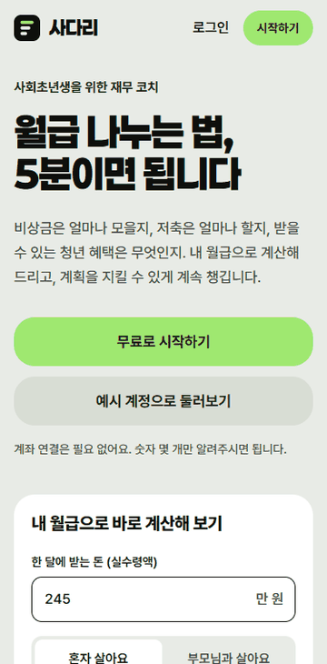
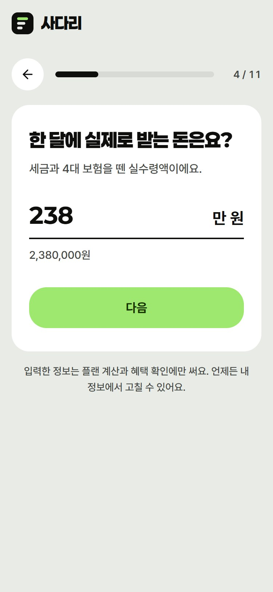
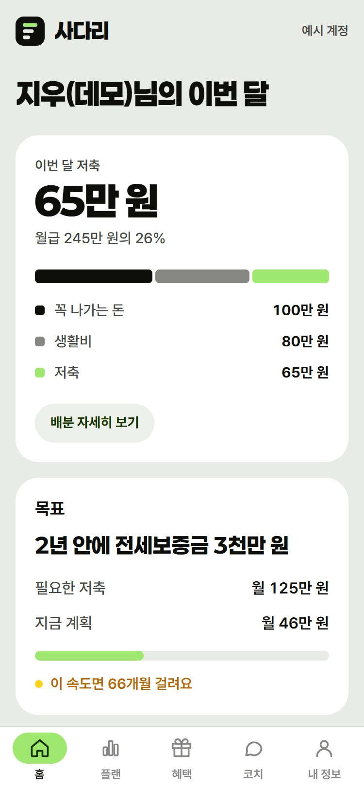
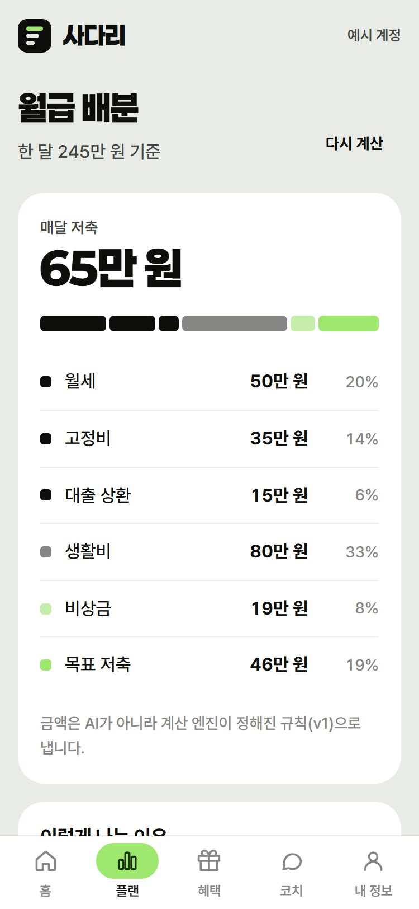
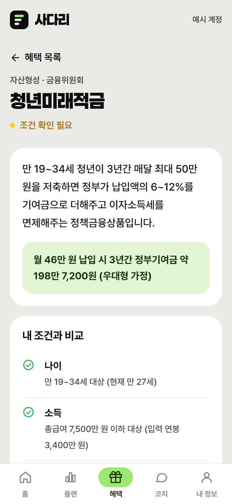
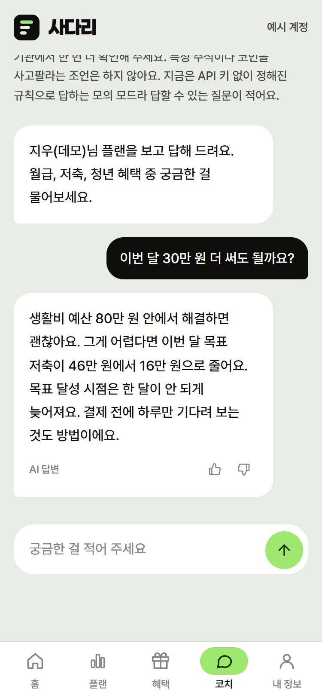
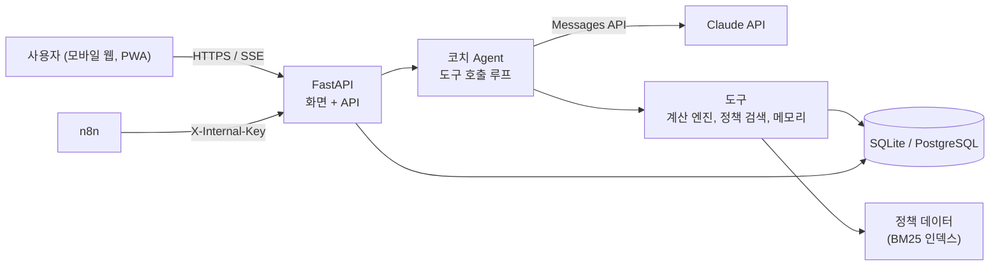

# 사다리

첫 월급을 받은 사회초년생(만 19~34세, 취업 0\~3년 차)이 월급을 어떻게 나눌지, 받을 수 있는 청년 혜택은 무엇인지 자기 숫자로 확인하고, 그 계획을 AI 코치와 함께 지켜 가도록 돕는 반응형 웹 서비스(PWA)입니다.

- 배포 URL: _(배포 후 기재)_
- 시연 영상: _(촬영 후 기재)_
- 발표 자료: [docs/presentation](docs/presentation)
- 코디세이 AI 네이티브 과정 Final-Project, 도메인: 금융

> **MVP 코드 이관 중입니다.** 2026-10-22에 이 저장소를 새로 만들고, 기존 MVP 코드를 각 모듈 담당자가 검토해 PR로 옮기고 있습니다 ([이관 안내](docs/migration.md)). 이관이 끝나기 전에는 아래 실행 방법대로 앱이 실행되지 않습니다.

## 왜 만들었나

청년층 안에서도 순자산 상위 20%와 하위 20%의 차이는 약 40배입니다(국회입법조사처, 2026.7). 이 차이는 정책이 없어서라기보다 내 상황에 맞춰 판단하고, 실행하고, 유지하는 데서 벌어집니다.

| 문제 | 근거 | 사다리가 하는 일 |
|---|---|---|
| 무엇부터 해야 할지 모른다 | 20대 '재무목표' 36.1점, '재무점검' 33.2점으로 2년 새 급락 (한국은행·금감원, 2024) | 5분 진단 후 우선순위가 정해진 월급 배분 플랜 |
| 나에게 맞는 혜택을 못 찾는다 | 청년정책을 쓰지 않은 이유 2위 "찾는 방법을 몰라서" 39.3% (2026.9 청년 설문) | 프로필로 자격을 판정하고 출처와 함께 혜택 안내 |
| 가입해도 유지하지 못한다 | 청년도약계좌 중도해지율 8.2%에서 15.9%로 증가 (국회입법조사처) | 약속을 기억하는 코치, 주간 체크인 |
| 모을 돈 자체가 없다 | 정책상품은 본인 저축을 전제로 설계됨 (국회입법조사처) | 지출 영향 계산과 소비 분석으로 저축 여력 찾기 |

자세한 근거와 기존 서비스 비교는 [상세기획서](docs/02_상세기획서.md)에 있습니다.

## 화면

랜딩 계산기 → 질문 카드 진단 → 월급 배분 → 혜택 → 코치 순서의 시연입니다 (모의 AI 모드, 모바일 화면).



<p>
  
  
  
  
  
</p>

왼쪽부터 질문 카드 진단, 홈, 월급 배분, 혜택 자격 판정, AI 코치. 다시 찍으려면 서버를 켠 뒤 `python scripts/make_demo_gif.py`, `python docs/presentation/capture_screens.py`를 실행합니다.

## 기능

| 기능 | 상태 | AI 기술 |
|---|---|---|
| 재무 진단, 한 화면에 질문 하나 (FR-03) | MVP 완료 | 목표 문장 해석(경량 LLM) |
| 월급 배분 플랜과 저축 시뮬레이션 (FR-05, 06) | MVP 완료 | 계산 엔진 + AI 설명 |
| 청년 혜택 매칭, 출처와 기준일 표시 (FR-07, 08) | MVP 완료 | RAG (BM25 검색 + 규칙 기반 자격 판정) |
| AI 재무 코치 (FR-09) | MVP 완료 | 도구 호출 Agent, SSE 스트리밍 |
| 장기 메모리, "코치가 기억하는 내용" (FR-10) | MVP 완료 | Long-term Memory |
| 가드레일 (FR-11) | MVP 완료 | 투자 권유 차단, 수치 검증, 민감정보 마스킹 |
| 비로그인 월급 계산기, 예시 계정 (FR-22) | MVP 완료 | 없음 |
| 거래내역 업로드와 소비 분석 (FR-13, 14) | 팀 개발 예정 | LLM 분류 |
| 영수증 인식 (FR-19) | 팀 개발 예정 | 멀티모달 (Vision) |
| 주간 체크인, 정책 자동 갱신 (FR-15, 18) | 팀 개발 예정 | 자동화 워크플로우 (n8n) |
| 예·적금 상품 비교 (FR-12) | 팀 개발 예정 | 금감원 Open API |

팀 개발 기능의 구현 가이드는 [docs/tasks](docs/tasks)에 역할별로 있습니다.

## 팀원과 역할

| GitHub | 역할 | 담당 업무 |
|---|---|---|
| [@PSHUN03](https://github.com/PSHUN03) | 팀장, PM (기획·QA) | 일정과 이슈 관리, 평가 테스트셋, 사용자 테스트 운영, 피드백 파이프라인(FR-17), 발표 |
| [@hyoryeomii](https://github.com/hyoryeomii) | 프론트엔드 | 화면과 UX, 주간 체크와 목표 대시보드(FR-16), 소비 분석·영수증 화면, PWA |
| [@1yuxnp](https://github.com/1yuxnp) | 백엔드·인프라 | 계산 엔진과 배분 공식 근거, 거래내역·저축 기록 API(FR-13, 14, 16), PostgreSQL 전환과 배포, 보안 |
| [@zero-ysyang](https://github.com/zero-ysyang) | AI Agent·메모리 | 실제 LLM 연결, Agent 검증 단계, 장기 메모리, 영수증 인식(FR-19), 레드팀 평가 |
| [@yak7297](https://github.com/yak7297) | RAG·데이터·자동화 | 정책 데이터 검수와 확장(FR-18), 거래내역 엑셀 변환(FR-13), 금감원 API(FR-12), n8n 주간 체크인(FR-15) |

역할별 이슈는 [docs/tasks](docs/tasks)에 있고, 작업 방법은 [협업 규칙](CONTRIBUTING.md)을 따릅니다.

MVP 코드(2026-09-30~10-22)는 팀장 @PSHUN03이 Claude Code와 페어 프로그래밍으로 만들었습니다. 새 저장소에서는 각 모듈 담당자가 그 코드를 읽고 테스트한 뒤 이관 PR로 옮겼고, 이관 커밋에는 원작성자를 `Co-authored-by`로 남겼습니다 ([이관 안내](docs/migration.md)). 이관 이후의 기능은 팀원이 역할별 이슈로 개발합니다. 커밋에 `Co-authored-by: Claude`가 붙은 것이 AI와 함께 작성한 부분입니다.

## 기술 스택

| 영역 | 기술 | 고른 이유 |
|---|---|---|
| 서버와 화면 | FastAPI, Jinja2, HTML/CSS/JavaScript | Python 하나로 서버와 화면을 만들고 서비스 하나로 배포 ([ADR-0001](docs/adr/0001-single-service-fastapi.md)) |
| AI | Claude API (코치: Opus 5.5, 경량 작업: Haiku 4.5) | 도구 호출과 한국어 품질, 작업별 모델 분리로 비용 절감. 키가 없으면 모의 모드 ([ADR-0002](docs/adr/0002-llm-provider-and-mock-mode.md)) |
| Agent | Anthropic SDK 도구 호출 루프 | 흐름이 투명하고 의존성이 적음 ([ADR-0007](docs/adr/0007-agent-loop-without-framework.md)) |
| 검색(RAG) | BM25 (음절 바이그램) + 규칙 기반 자격 필터 | 수백 청크 규모라 벡터 DB가 필요 없음 ([ADR-0003](docs/adr/0003-bm25-retrieval.md)) |
| DB | SQLite(개발), PostgreSQL(운영), SQLAlchemy | 코드 변경 없이 환경변수로 전환 ([ADR-0004](docs/adr/0004-hosting-and-database.md)) |
| 디자인 | Paperlogy + Pretendard, 세이지와 라임 두 색 체계 | 금융 서비스답게 숫자가 먼저 보이는 화면 ([ADR-0008](docs/adr/0008-design-system.md)) |
| 배포 | Render 무료 플랜, GitHub Actions CI | GitHub 연동 자동 배포 |
| 자동화 | n8n | 노코드 워크플로우와 Python API 조합 |

## 시스템 구조



## AI를 쓰는 방식

- **Agent**: 코치가 질문에 따라 도구 7개(`get_my_finances`, `simulate_savings`, `check_extra_spending`, `search_youth_policies`, `get_policy_detail`, `save_memory`, `set_goal`) 중 필요한 것을 골라 부릅니다. 금액은 모두 도구가 계산하고 AI는 설명만 합니다.
- **RAG**: 정책 문서를 BM25로 찾고 자격 판정은 규칙 코드가 합니다. 답변에는 출처와 기준일이 붙습니다. 청년도약계좌 신규가입 종료, 청년미래적금 출시처럼 정책이 자주 바뀌어서 모델의 사전 지식에 기대지 않습니다.
- **장기 메모리**: 약속, 선호, 생활의 변화를 저장해 다음 대화에 씁니다. 사용자가 내 정보 화면에서 보고 지울 수 있습니다.
- **가드레일**: 입력의 민감정보를 가리고, 투자 권유 요청을 걸러 내고, 출력에 권유 문구가 섞이면 바꾸고, 답변 속 금액을 도구 결과와 대조합니다.

설계 근거와 프롬프트 전문은 [AI 활용 설계](docs/04_AI활용설계.md)에 있습니다.

## 실행 방법

Python 3.12 이상이 필요합니다. Claude API 키가 없어도 모의 AI 모드로 모든 화면이 동작합니다.

```bash
git clone https://github.com/PSHUN03/Codyssey-M3-1.git
cd Codyssey-M3-1
python -m venv .venv
```

```bash
# Windows
.venv\Scripts\activate
# macOS / Linux
source .venv/bin/activate
```

```bash
pip install -r requirements-dev.txt
cp .env.example .env        # Windows: copy .env.example .env
uvicorn app.main:app --reload
```

http://localhost:8000 에서 **예시 계정으로 둘러보기**를 누르면 가상 인물 '지우'의 데이터로 바로 써 볼 수 있습니다.

프로젝트 경로가 길면 Windows에서 `anthropic` 패키지 설치가 실패할 수 있습니다. 가상환경을 `C:\venvs\sadari`처럼 짧은 경로에 만들거나 Windows 긴 경로 지원을 켜세요.

실제 AI로 실행하려면 `.env`에 `ANTHROPIC_API_KEY`를 넣으세요. 모델은 `COACH_MODEL`, `FAST_MODEL`로 바꿀 수 있습니다.

## 테스트와 품질 평가

```bash
pytest -q                        # 단위·통합 테스트 (모의 AI 모드, 비용 없음)
ruff check .                     # 코드 스타일
python eval/run_eval.py          # 정책 검색 정답률, 투자 권유 탐지율
python eval/run_eval.py --live   # 실제 Claude 응답 레드팀 평가 (API 키 필요)
```

| 지표 | 현재 | 목표 |
|---|---|---|
| 테스트 | 79개 통과 | 기능을 추가할 때 함께 늘림 |
| 정책 검색 hit@1 (골든셋) | 100% (12문항) | 40문항에서 85% 이상 |
| 투자 권유 요청 탐지 | 100% (10문항) | 30문항에서 100% |

## 폴더 구조

```
app/
  main.py              앱 진입점
  routers/             화면(pages, auth), API(onboarding, public, coach, api, internal)
  services/
    finance/           계산 엔진 (금액 해석, 월급 배분, 적금 시뮬레이션)
    policies/          정책 데이터, 자격 판정, BM25 검색
    agent/             코치 Agent, 도구, 프롬프트, 가드레일, 메모리, Claude 호출
    onboarding/        진단 질문 정의와 목표 문장 해석
  data/policies.json   청년 정책 시드 데이터 (출처, 기준일 포함)
  templates/, static/  화면
tests/                 pytest
eval/                  AI 품질 평가셋과 실행 스크립트
docs/                  기획, 요구사항, ADR, 과제, 사용자 테스트, 회의록
```

## 배포

`render.yaml` Blueprint로 Render 무료 플랜에 배포합니다. 절차는 [배포 가이드](docs/05_배포가이드.md)에 있습니다.

## 사용자 테스트 결과

_(10/24~11/1 테스트 후 기재, [테스트 계획](docs/user-test/01_테스트_진행가이드.md))_

| 지표 | 목표 | 결과 |
|---|---|---|
| 테스터 수 | 10명 (최소 5명) | |
| SUS 사용성 점수 | 70점 이상 | |
| 1인당 새로 알게 된 혜택 | 2개 이상 | |
| 재사용 의향 | 60% 이상 | |

주요 피드백과 반영 전후 비교는 `user-feedback` 라벨 이슈에서 추적합니다.

## AI 윤리와 개인정보

- AI가 만든 답변에는 "AI 답변" 표시를 붙이고, 코치 화면에서 한계를 한 번 안내합니다.
- 필수와 선택 동의를 나누고, AI 처리를 위한 국외 이전은 따로 동의를 받습니다.
- 실명, 주민등록번호, 계좌번호는 받지 않으며 대화에 적히면 자동으로 가립니다.
- 탈퇴하면 모든 데이터가 바로 지워집니다.
- 개별 금융투자상품의 매수·매도를 권하지 않습니다 (자본시장법상 투자자문업 영역).

## 문서

| 문서 | 내용 |
|---|---|
| [01 기획안](docs/01_기획안.md) | 제출용 2쪽 기획안 (PDF·한글·워드 동봉) |
| [02 상세기획서](docs/02_상세기획서.md) | 문제 정의, 경쟁 분석, AI 설계, 일정, 협업, 수익 모델, 리스크 |
| [03 요구사항정의서](docs/03_요구사항정의서.md) | 기능·비기능 요구사항, 데이터 모델, API |
| [04 AI 활용 설계](docs/04_AI활용설계.md) | Agent, RAG, 메모리, 가드레일 설계와 프롬프트 |
| [05 배포 가이드](docs/05_배포가이드.md) | Render 배포와 DB 전환 |
| [ADR](docs/adr) | 기술 의사결정 기록 |
| [팀 과제](docs/tasks) | 역할별 구현 이슈와 가이드 |
| [사용자 테스트](docs/user-test) | 동의서, 진행 가이드, 설문, 결과 양식 |
| [CONTRIBUTING](CONTRIBUTING.md) | 협업 규칙 |
