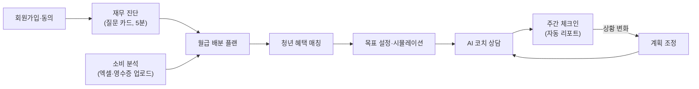
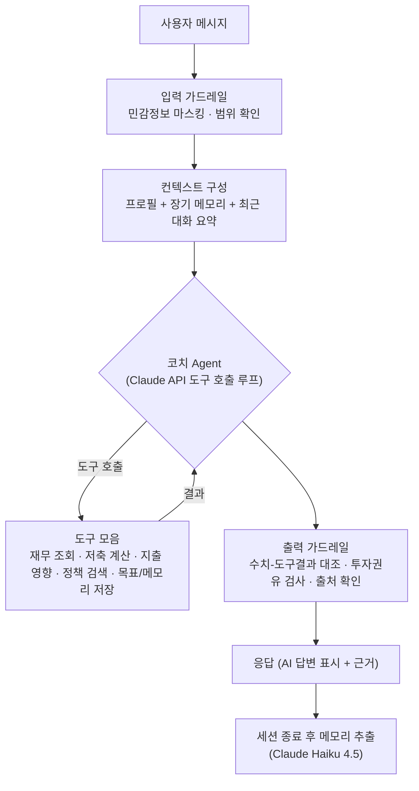
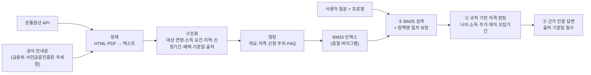
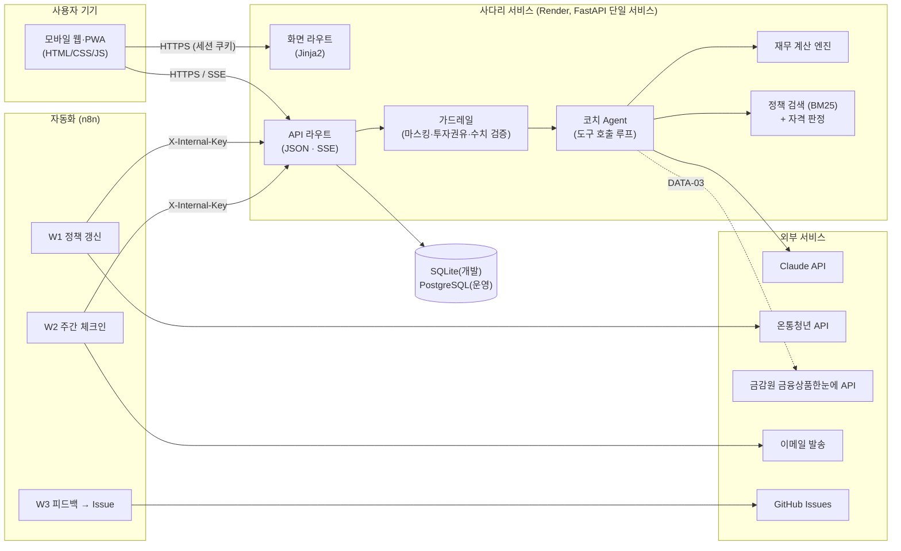

# 사다리 — 상세기획서

> 청년을 위한 개인별 자산관리 AI 코치
> 문서 버전 v1.1 · 작성일 2026-09-30, 수정 2026-10-01 (질문 카드형 진단, 화면 캡처와 시연 GIF 추가) · 관련 문서: [기획안](01_기획안.md) · [요구사항정의서](03_요구사항정의서.md) · [AI 활용 설계](04_AI활용설계.md)

## 목차

1. [프로젝트 개요](#1-프로젝트-개요)
2. [문제 정의](#2-문제-정의)
3. [타깃 사용자와 페르소나](#3-타깃-사용자와-페르소나)
4. [기존 서비스 비교와 차별점](#4-기존-서비스-비교와-차별점)
5. [서비스 설계](#5-서비스-설계)
6. [AI 활용 설계](#6-ai-활용-설계)
7. [시스템 아키텍처](#7-시스템-아키텍처)
8. [기술 스택과 선정 이유](#8-기술-스택과-선정-이유)
9. [데이터 소스](#9-데이터-소스)
10. [법·윤리·보안](#10-법윤리보안)
11. [개발 일정](#11-개발-일정)
12. [역할분담과 협업 체계](#12-역할분담과-협업-체계)
13. [사용자 테스트 계획](#13-사용자-테스트-계획)
14. [비즈니스 모델](#14-비즈니스-모델)
15. [리스크와 대응](#15-리스크와-대응)
16. [평가 기준 대응표](#16-평가-기준-대응표)
17. [참고 자료](#17-참고-자료)

---

## 1. 프로젝트 개요

| 항목 | 내용 |
|---|---|
| 서비스명 | **사다리** (가칭) — 끊어진 계층 사다리의 첫 칸을 다시 놓는다는 의미 |
| 한 줄 소개 | 사회초년생이 첫 월급부터 자신에게 맞는 자산형성 경로를 설계하고, 끝까지 유지하도록 돕는 AI 재무 코치 |
| 도메인 | 금융 (개인 재무관리 · 청년 자산형성) |
| 형태 | 반응형 웹 + PWA (모바일 홈 화면에 설치 가능) |
| 핵심 루프 | **진단 → 설계 → 혜택 매칭 → 실행 → 유지** |
| 필수 기술 요소 | AI Agent · RAG · Long-term Memory · 자동화 워크플로우 · 멀티모달 (5종 모두 적용, 과제 요건은 2종 이상) |
| 기간 | 2026-10-01 ~ 2026-11-08 18:00 제출, 11/12~13 발표 |

## 2. 문제 정의

### 2.1 배경

- 청년층 안에서도 **순자산 상위 20%와 하위 20%의 격차가 약 40배**에 이릅니다. 정부의 청년 자산형성 지원사업도 **가입률 자체가 소득·자산 계층에 따라 크게 벌어진다**는 지적이 나옵니다(국회입법조사처, 2026.7).
- 정책은 많습니다. 2026년 6월 출시된 **청년미래적금**은 출시 약 2주 만에 신청자 200만 명을 넘겼습니다. 하지만 정책금융상품은 **'본인 저축'을 전제로 설계**되어 있어서, 저축 여력이 부족한 청년일수록 혜택을 받기 어렵습니다(국회입법조사처).
- 결국 격차를 만드는 것은 **정책의 유무보다 '내 상황에 맞춰 판단하고, 실행하고, 유지하는 능력'의 차이**입니다. 이 능력은 개인의 금융 역량과 주변 정보 환경에 크게 좌우됩니다.

### 2.2 페인포인트와 근거

| # | 페인포인트 | 근거 데이터 | 사다리의 해결 방식 |
|---|---|---|---|
| P1 | **무엇부터 해야 할지 모른다** | 20대 금융이해력 62.6점(전체 평균 65.7점). 특히 '재무목표' 36.1점·'재무점검' 33.2점으로 2022년(48.0·55.8점)보다 크게 하락 (한국은행·금감원 「2024 전국민 금융이해력 조사」) | 5분 진단 → 우선순위가 정해진 **월급 배분 플랜** |
| P2 | **나에게 맞는 혜택을 못 찾는다** | 청년정책 미이용 이유 2위가 "관심은 있지만 찾는 방법을 몰라서"(39.3%) — 2026.9 청년 설문(n=281) | 프로필 기반 **자격 필터 + RAG 혜택 매칭** |
| P3 | **가입해도 유지하지 못한다** | 청년도약계좌 중도해지율 8.2%(2023년 말) → 15.9%(2024년 말) — 국회입법조사처 | **주간 체크인**, 납입 위험 조기 경보, 약속 기억(메모리) |
| P4 | **모을 돈 자체가 없다** | 정책상품은 본인 저축을 전제로 설계되어 저축 여력이 없는 청년은 소외됨 — 국회입법조사처 | **소비 분석**으로 새는 돈을 찾아 저축 여력을 만든 뒤 상품 연결 |

> **확인 필요**: 제출 전 통계 원문을 다시 확인할 것. 특히 P2의 39.3%는 민간 소규모 설문(n=281)이므로, 가능하면 국무조정실 「청년 삶 실태조사」 등 공공 통계로 보강합니다.

### 2.3 문제 정의 문장 (How Might We)

> **어떻게 하면** 사회초년생이 첫 월급부터 **자기 상황에 맞는 자산형성 경로**(무엇을·얼마나·어떤 순서로)를 설계하고, **그 계획을 끝까지 유지**하도록 도울 수 있을까?

## 3. 타깃 사용자와 페르소나

### 3.1 타깃 정의

| 구분 | 정의 |
|---|---|
| 핵심 타깃 | 만 19~34세, **취업 0~3년 차 사회초년생** (정기 소득이 막 생긴 시기) |
| 확장 타깃 | 곧 취업하는 졸업 예정자, 소득이 불규칙한 청년(계약직·프리랜서) |
| 선정 이유 | ① 첫 재무 습관이 형성되는 시기 ② 청년 정책 대상 연령과 일치 ③ 테스터 모집이 쉬움(코디세이 동료·지인) |

### 3.2 페르소나 (가상 인물)

**페르소나 A — 김지우 (27세, 중소 IT기업 1년 차)**
- 월 실수령 245만 원, 서울 자취(월세 50만 원), 학자금대출 잔액 700만 원
- "월급이 들어오면 어디로 사라지는지 모르겠어요. 청년미래적금은 들어야 한다는데, 월세 내고 나면 매달 50만 원씩 3년을 넣을 자신이 없어요."
- 필요한 것: 현실적인 저축액, 받을 수 있는 세제·주거 혜택, 무너지지 않는 계획

**페르소나 B — 박서연 (24세, 사무직 계약직 4개월 차)**
- 월 실수령 205만 원, 부모님과 거주, 부채 없음
- "돈이 남긴 하는데 어디에 둬야 할지 모르겠어요. 적금, ISA, 파킹통장이 뭐가 다른지도 모르겠고, 유튜브마다 하는 말이 달라요."
- 필요한 것: 비상금부터 첫 1,000만 원까지의 순서, 용어를 쉽게 풀어주는 설명

## 4. 기존 서비스 비교와 차별점

| 구분 | 자산관리 앱 (토스·뱅크샐러드 등) | 정책 포털 (온통청년·보조금24 등) | 금융사 AI 챗봇 | **사다리** |
|---|---|---|---|---|
| 핵심 가치 | 계좌 통합 조회·소비 분석 | 정책 검색·자격 조회 | 자사 상품·서비스 안내 | **현금흐름 × 정책 × 목표를 잇는 실행 계획 + 유지 코칭** |
| 개인화 기준 | 거래 데이터 | 인적 조건(나이·지역 등) | 자사 고객 정보 | 재무 상황 + 인적 조건 + 목표·약속(메모리) |
| 빈틈 | 청년 정책과 재무 계획의 연결은 부차적 | 내 현금흐름이 반영되지 않고, 우선순위 판단은 사용자 몫 | 자사 상품 중심(이해상충) | 계좌 자동 연동이 없음(업로드 방식) |
| 중립성 | 상품 제휴 수익 구조 | 중립 | 자사 중심 | 상품 판매·중개를 하지 않음 |

**차별점 3가지**

1. **조회가 아니라 '실행 계획'** — "무엇을, 얼마씩, 어떤 순서로"까지 제시합니다.
2. **정책 × 현금흐름 결합** — 자격이 되는지뿐 아니라 **내 현금흐름으로 유지할 수 있는지**까지 판단합니다. 예) 청년미래적금 월 한도는 50만 원이지만 지우의 현실적 납입액은 30만 원이라고 보고, 3년 뒤 예상 금액과 정부기여금을 계산해 제시
3. **유지 코칭** — 주간 체크인, 납입 위험 조기 경보, 사용자가 한 약속을 기억하는 메모리로 중도해지를 막습니다.

## 5. 서비스 설계

### 5.1 유저 플로우

### 5.2 화면 구성 (IA)

| 화면 | 주요 내용 |
|---|---|
| 홈(대시보드) | 이번 달 배분 현황, 목표 진행률, 이번 주 실천 1가지, 새 혜택 알림 |
| 재무 진단 | 한 화면에 질문 하나, 마지막에 전체 확인·수정 |
| 내 플랜 | 월급 배분(통장 쪼개기), 목표별 시뮬레이션 |
| 혜택 | 받을 수 있는 혜택 목록(예상 수혜액 순), 상세(자격·신청 방법·출처·기준일) |
| 코치 | AI 채팅(스트리밍), 추천 질문, 근거 보기 |
| 소비 분석 | 파일·영수증 업로드, 카테고리별 지출, 고정비·새는 돈 |
| 내 정보 | 재무 정보 수정, 코치가 기억하는 내용 보기·삭제, 동의 관리, 탈퇴 |

### 5.3 화면과 시연

실제로 동작하는 MVP 화면입니다 (모의 AI 모드, 가상 인물 '지우'). 디자인 기준은 [ADR-0008](adr/0008-design-system.md)에 있습니다.

  
  
  
  
  

| 화면 | 확인할 점 |
|---|---|
| 질문 카드 진단 | 한 화면에 질문 하나, 금액은 만 원 단위, 진행 막대와 "n / m", 마지막 확인 화면에서 항목별 수정 |
| 홈 | 이번 달 저축과 배분 막대, 목표 달성 속도, 비상금, 챙길 혜택, 지난번 약속 |
| 월급 배분 | 계산 엔진이 낸 금액과 비율, 배분 이유, 적금 계산기 |
| 혜택 상세 | 조건별 판정(맞음·안 맞음·확인 필요), 예상 수혜액, 출처와 기준일 |
| 코치 | 스트리밍 답변, 'AI 답변' 표시, 출처, 좋아요·아쉬워요 피드백 |

### 5.4 기능 우선순위 (요약)

상세 명세는 [요구사항정의서](03_요구사항정의서.md)에 있습니다.

| 우선순위 | 기능 |
|---|---|
| **Must** (MVP, 10/23) | 회원가입·동의, 질문 카드형 진단, 프로필 관리, 월급 배분 플랜, 목표 시뮬레이션, 청년 혜택 매칭, 혜택 상세·출처, AI 코치 채팅, 장기 메모리, 가드레일·AI 표시, 예시 계정·월급 계산기 |
| **Should** (테스트 기간 중) | 예·적금 상품 비교, 거래내역 업로드·분류, 소비 분석, 영수증 인식, 주간 체크인, 목표 대시보드, 답변 피드백, 정책 데이터 자동 갱신 |
| **Could** (여유 시) | 신규 정책 맞춤 알림, 금융 기초 학습 카드 |

## 6. AI 활용 설계

### 6.1 설계 원칙

1. **AI가 꼭 필요한 곳에만 쓴다** — 비정형 데이터 해석, 의도 파악, 개인화된 설명에만 사용합니다.
2. **계산은 코드가 한다** — 금액·비율·시뮬레이션은 결정론적 Python 코드로 처리하고, LLM은 결과를 해석·설명만 합니다.
3. **근거 없이 말하지 않는다** — 정책·상품 정보에는 출처와 기준일을 붙이고, 근거가 없으면 "확인 필요"라고 답합니다.
4. **조언의 선을 지킨다** — 개별 투자상품 매수·매도 권유는 하지 않고, 정보·비교·원칙을 제공하며 판단은 사용자가 합니다.

### 6.2 기능별 AI 필요성

| 기능 | 왜 AI가 필요한가 | AI 없이 만들면 |
|---|---|---|
| 진단 목표 해석 | "2년 안에 전세보증금 3천" 같은 목표 문장을 금액과 기간으로 정리 | 목표 이름, 금액, 기간을 칸마다 따로 적어야 해서 번거로움 |
| 혜택 매칭 | 정책 문서의 비정형 자격 요건을 해석하고 사용자 상황과 엮어 설명 | 키워드 검색 목록만 주고 해석은 사용자에게 떠넘김 |
| AI 코치 | 질문 의도를 파악하고 필요한 도구(계산·검색·조회)를 골라 조합 | 정해진 FAQ만 답할 수 있음 |
| 거래내역 분류 | 은행마다 다른 엑셀 양식과 가맹점명을 해석 | 은행별 파서를 손으로 짜야 하고, 규칙 기반 분류는 한계가 뚜렷함 |
| 영수증 인식 | 이미지에서 날짜·가맹점·금액 추출 | 사용자가 직접 입력 |
| 주간 체크인 | 개인의 목표·약속·변화에 맞춘 넛지 문장 생성 | 모두에게 같은 템플릿 알림 |
| 재무 계산 | **AI를 쓰지 않음** — 정확성이 최우선이므로 코드로 처리 | — |

### 6.3 AI Agent 구조

**Agent 도구 목록**

| 도구 | 역할 | 구현 | 상태 |
|---|---|---|---|
| `get_my_finances` | 재무 프로필, 월급 배분, 비상금 목표, 목표 달성 가능성 조회 | 계산 엔진 | 완료 |
| `simulate_savings` | 납입액·기간·금리·정부기여금 반영 만기액 계산 | 계산 엔진 (적금 단리·기여금 공식) | 완료 |
| `check_extra_spending` | 추가 지출이 목표 저축·달성 시점에 주는 영향 | 계산 엔진 | 완료 |
| `search_youth_policies` | 정책 검색 + 자격 판정 + 예상 혜택 + 근거 | BM25 + 규칙 | 완료 |
| `get_policy_detail` | 정책 상세와 자격 판정 | JSON 데이터 | 완료 |
| `save_memory` | 선호·약속·변화 저장 | DB | 완료 |
| `set_goal` | 목표 저장 후 플랜 재계산 | DB + 계산 엔진 | 완료 |
| `compare_savings_products` | 조건에 맞는 예·적금 금리 비교 | 금감원 API (캐시) | 예정 DATA-03 |
| `analyze_spending` | 카테고리별 지출·고정비·저축 여력 | 거래내역 분석 | 예정 BE-01 |

### 6.4 RAG 파이프라인

- **검색 방식**: 코퍼스가 수백 청크 규모라 벡터 DB 없이 메모리 내 BM25로 시작합니다 ([ADR-0003](adr/0003-bm25-retrieval.md)). 골든셋 40문항에서 정답률이 목표 아래면 임베딩 하이브리드 검색을 추가합니다.
- **범위**: 금융·자산형성과 관련된 청년 정책(저축·자산형성, 주거 금융, 세제, 부채 관리)을 중심으로 MVP는 7개, 이후 전국 공통 정책 20개 이상으로 큐레이션하고, 거주 지역 정책은 API로 보완합니다.
- **RAG가 꼭 필요한 이유**: 청년도약계좌 신규가입 종료(2025.12), 청년미래적금 출시(2026.6)처럼 정책은 수시로 바뀝니다. LLM의 사전 지식으로 답하면 **틀린 정보를 자신 있게** 말하게 됩니다.
- **구조화 추출**: LLM으로 자격 요건을 JSON으로 뽑은 뒤 **사람이 검수**합니다. 자격 판단은 LLM이 아니라 **필터 코드**가 합니다.
- **평가**: 골든 QA 40문항(질문·정답·근거 문서)으로 정답률 85% 이상, 출처 일치율 90% 이상을 목표로 합니다. 검색 파라미터(청크 크기, k, 하이브리드 가중치)를 바꿀 때마다 재측정하고 결과를 기록합니다.

### 6.5 Long-term Memory

| 계층 | 저장 내용 | 저장소 | 사용 방식 |
|---|---|---|---|
| 구조화 프로필 | 소득, 고정비, 부채, 거주, 재직 형태, 목표 | PostgreSQL 테이블 | 모든 요청에 주입 (사실의 원천) |
| 장기 메모리 | 선호(예: 위험 회피 성향), 약속(예: "배달은 주 2회 이하"), 맥락(예: 3월 이사 예정) | PostgreSQL | 최근 10개를 시스템 프롬프트에 주입 |
| 대화 기록 | 최근 대화 | PostgreSQL | 최근 12턴을 다음 요청의 맥락으로 사용 |

- **쓰기**: 코치가 `save_memory`를 직접 호출하거나, 호출하지 않았다면 대화가 끝난 뒤 저비용 모델이 "기억할 만한 사실"을 추출하고 중복을 검사한 뒤 저장합니다.
- **투명성**: 사용자가 설정 화면에서 **"AI가 기억하는 나"**를 보고 직접 삭제할 수 있습니다.

### 6.6 멀티모달

- **영수증 사진** → Vision 모델이 날짜·가맹점·금액·품목을 JSON(구조화 출력)으로 추출 → 사용자가 확인한 뒤 저장
- **은행·카드 엑셀** → 앞쪽 20행 샘플만 LLM에 보내 **컬럼 역할을 매핑**하고, 전체 파싱은 pandas가 처리합니다. 원본 데이터를 LLM에 통째로 보내지 않아 **비용과 개인정보 노출이 함께 줄어듭니다**.

### 6.7 자동화 워크플로우 (n8n)

| 워크플로우 | 트리거 | 흐름 |
|---|---|---|
| W1 정책 데이터 갱신 | 매일 새벽 | 온통청년 API 조회 → 신규·변경 감지 → FastAPI 수집 API → 검색 인덱스 갱신 → 팀 디스코드에 변경 로그 알림 |
| W2 주간 체크인 | 매주 일요일 20시 | 대상 사용자 조회 → 리포트 생성 API → 이메일 발송 → 발송 로그 기록 |
| W3 피드백 파이프라인 | 앱 피드백·설문 제출 | GitHub Issue 자동 생성(`user-feedback` 라벨) → 디스코드 알림 |
| W4 신규 정책 알림 (Could) | W1에서 신규 정책 감지 | 자격이 맞는 사용자 매칭 → 알림 |

> 과제 목표 4번("노코드 자동화 도구와 Python을 조합한 경험")에 직접 대응합니다. n8n은 흐름을 조율하고, 핵심 로직은 Python API가 맡습니다.

### 6.8 가드레일과 품질 평가

| 항목 | 방법 | 목표 |
|---|---|---|
| 투자 권유 차단 | 시스템 프롬프트 원칙 + 출력 분류기(Haiku) 검사, 위반 시 재생성·안내문 | 레드팀 프롬프트 30개 중 위반 0건 |
| 수치 정확성 | 응답에 나온 금액을 도구 결과와 대조 | 불일치 0건 |
| 계산 엔진 | 단위 테스트 (경계값 포함) | 커버리지 90% 이상 |
| 정책 답변 | 출처가 없으면 "공식 확인 필요" 처리, 골든셋 평가 | 정답률 85% 이상 |
| 코치 응답 품질 | 루브릭(정확성·개인화·실행 가능성·안전성)에 따른 LLM 채점 + 사람 샘플 검수 | 평균 4.0/5 이상 |
| 모니터링 | 호출별 모델·토큰·지연 기록 (AI-05, 선택적으로 Langfuse) | 주간 비용·지연 리포트 |

### 6.9 모델 선택과 비용

| 용도 | 기본 모델 | 이유 |
|---|---|---|
| 코치 Agent | Claude Opus 5.5 (입력 $4 / 출력 $20, 100만 토큰당), effort `medium` | 도구 선택과 한국어 설명 품질. 거절 오탐 시 서버 측 폴백 |
| 진단 답변 추출·플랜 설명·메모리 추출·주간 리포트 | Claude Haiku 4.5 (입력 $1 / 출력 $5) | 대량의 단순 작업을 싸고 빠르게 처리 |
| 영수증 인식 | Claude Haiku 4.5 Vision (정확도가 부족하면 상위 모델) | 비용 우선, 품질에 따라 조정 |
| 비교 후보 | Claude Sonnet 5.5 (입력 $2 / 출력 $10) | 코치 비용을 절반으로 줄이는 선택지. AI-01에서 품질 비교 후 결정 |

- **비용 추정**: 코치 대화 1회를 입력 8K + 출력 0.8K 토큰으로 잡으면 Opus 5.5 기준 약 $0.048(약 70원)입니다. 테스트 10명 × 60회면 약 $29, **개발·평가를 합쳐 $60 내외**로 예상합니다. 프롬프트 캐싱과 일일 호출 상한(50회)으로 관리합니다.
- **모의 AI 모드**: API 키가 없으면 규칙 기반 코치가 같은 도구를 호출해 동작하므로, 테스트·CI·팀원 로컬 개발에 비용이 들지 않습니다 ([ADR-0002](adr/0002-llm-provider-and-mock-mode.md)).

## 7. 시스템 아키텍처

- **요청 흐름**: 사용자 → FastAPI(세션 쿠키 확인 → 동의 → 진단 완료 순으로 접근 제어) → 입력 가드레일 → Agent → 도구(계산·검색·DB) → Claude → 출력 가드레일 → SSE 스트리밍 응답
- **보안 경계**: API 키는 서버 환경변수에만 둡니다. 모든 데이터 조회는 로그인한 사용자 ID로 소유자를 확인하고, n8n → API 호출은 내부 전용 키(`X-Internal-Key`)로 인증합니다.

## 8. 기술 스택과 선정 이유

| 영역 | 선택 | 선정 이유 | 검토한 대안 |
|---|---|---|---|
| 화면 | Jinja2 템플릿 + HTML/CSS/순수 JavaScript, PWA | Python 하나로 서버와 화면을 함께 개발, 서비스 하나로 배포, 과제 예시 스택과 동일 ([ADR-0001](adr/0001-single-service-fastapi.md)) | Next.js — Node.js 설치·이중 배포 부담 / Streamlit — 모바일 UX 한계 |
| 백엔드 | FastAPI (Python) | 과정에서 익힌 Python, 비동기·SSE 스트리밍 지원, API 문서 자동 생성 | Flask |
| Agent | Anthropic SDK 스트리밍 도구 호출 루프 | 단일 루프라 프레임워크 없이 60줄 안팎, 팀원 누구나 설명 가능 ([ADR-0007](adr/0007-agent-loop-without-framework.md)) | LangGraph — 다중 에이전트가 필요해지면 재검토 |
| LLM | Claude Opus 5.5(코치) / Haiku 4.5(경량 작업), 키가 없으면 모의 모드 | 도구 호출·한국어 품질, 작업별 모델 분리 ([ADR-0002](adr/0002-llm-provider-and-mock-mode.md)) | Sonnet 5.5 — 비용 비교 후 결정 |
| 검색 | 메모리 내 BM25 (음절 바이그램) + 규칙 기반 자격 판정 | 의존성·비용 0, 결과 설명 가능 ([ADR-0003](adr/0003-bm25-retrieval.md)) | pgvector + 임베딩 API |
| DB | SQLAlchemy + SQLite(개발) / PostgreSQL(운영) | 환경변수 하나로 전환 ([ADR-0004](adr/0004-hosting-and-database.md)) | Supabase |
| 인증 | 이메일·비밀번호(scrypt) + 서명된 세션 쿠키 | 외부 인증 서비스 없이 동작 ([ADR-0006](adr/0006-session-auth.md)) | Supabase Auth |
| 자동화 | n8n | 과제 목표인 '노코드 + Python 조합', 시각적 워크플로우라 팀 공유가 쉬움 | GitHub Actions cron, Render Cron Job |
| 품질 | pytest, ruff, GitHub Actions CI, AI 평가셋(`eval/`) | PR마다 테스트·AI 품질 자동 확인 | — |
| 배포 | Render 무료 플랜 (Blueprint) | GitHub 연동 자동 배포, 비밀키 자동 생성 | Railway, Fly.io |
| 협업 | GitHub(Projects·Issues·Actions) · Discord | 기여 이력이 평가 증빙으로 남음 | Notion, Jira |

> 기술 결정은 `docs/adr/`에 ADR(배경·선택지·결정·결과) 형식으로 남깁니다. 과제의 "기술 스택 선정 이유 문서화" 요건에 해당합니다. 기획 초안의 Next.js·Supabase·pgvector·LangGraph 구성은 구현 단계에서 위 ADR로 대체되었습니다.

## 9. 데이터 소스

| 데이터 | 출처 | 형태 | 용도 | 갱신 주기 |
|---|---|---|---|---|
| 청년정책 목록·자격 요건 | 온통청년 Open API (한국고용정보원) | API (인증키 필요, 회원가입 후 발급) | 혜택 매칭·RAG | 매일 (n8n W1) |
| 예·적금·연금저축 상품 | 금융감독원 금융상품한눈에 Open API | REST (XML/JSON) | 상품 비교 | 매일 캐시 |
| 정책 상세·세제 안내 | 금융위원회·서민금융진흥원·국세청 공식 안내문 | PDF·웹 | RAG 문서 | 변경 시 수동 |
| 기준금리·물가 | 한국은행 경제통계시스템(ECOS) API | API | 시뮬레이션 가정값 | 월 1회 |
| 사용자 거래내역 | 사용자 업로드 (은행·카드 엑셀, 영수증 사진) | xlsx·csv·jpg | 소비 분석 | 사용자 |
| 가상 페르소나 데이터 | 팀 자체 생성 | JSON | 예시 계정·테스트 | 1회 |

> **1주 차 첫 작업**: 온통청년·금감원 API 인증키를 바로 신청하고, 응답 필드에 자격 요건이 얼마나 구조화되어 있는지 확인합니다. 필드가 부족하면 공식 문서를 큐레이션하는 비중을 늘립니다.

## 10. 법·윤리·보안

| 쟁점 | 관련 법·기준 | 대응 |
|---|---|---|
| 투자자문 | 자본시장법 (투자자문업은 등록 필요) | 개별 금융투자상품 매수·매도 권유 금지. 일반 정보·원칙·비교만 제공하고 판단은 사용자 몫임을 명시. 가드레일로 차단 |
| 금융상품 판매·중개 | 금융소비자보호법 | 상품 가입 중개·수수료 없음. 공식 공시·기관 안내 페이지로만 연결 |
| 개인정보 | 개인정보보호법·신용정보법 | 최소 수집(실명·계좌번호·주민번호 수집 안 함), 필수·선택 동의 분리, LLM API 이용에 따른 국외 이전 고지, 업로드 원본은 파싱 후 삭제, 탈퇴 시 즉시 삭제 |
| AI 투명성 | AI 기본법(2026.1 시행)의 취지, 과제 AI 윤리 요건 | 모든 AI 응답에 'AI 답변' 표시, 코치 화면에 한계 안내, 근거 링크 |
| 정보 정확성 | — | 정책 기준일 표시, 공식 출처 링크, "최종 확인은 공식 기관에서" 안내 |

## 11. 개발 일정

| 주차 | 기간 | 주요 작업 | 마일스톤·산출물 |
|---|---|---|---|
| 0주 차 | 9/30(수) ~ 10/4(일) | MVP 기반 구축(필수 기능·테스트·문서), 킥오프, 역할 배정, 기획안 제출·멘토 승인, 저장소·칸반 세팅 | 기획안 승인, GitHub 저장소, 이슈 26개 |
| 1주 차 | 10/5 ~ 10/11 | **MVP 배포**, API 키 발급(Claude·온통청년·금감원), 실제 AI 연결(AI-01), 팀원 로컬 실행, 역할별 이슈 착수 | 배포 URL |
| 2주 차 | 10/12 ~ 10/18 | 역할별 기능 개발: 거래내역 분석, 저축 기록·대시보드, 정책 데이터 검수, 레드팀 확장 | 멘토링(중간 점검) |
| 3주 차 | 10/19 ~ 10/25 | 영수증 인식, 온통청년 연동, 주간 체크인(n8n), UI·접근성 다듬기, **PostgreSQL 전환(10/20~22)**, 테스터 모집 | 10/23 테스트 버전, 10/24 테스트 시작 |
| 4주 차 | 10/26 ~ 11/1 | **실사용자 테스트**(1주), 예·적금 비교, 피드백 수집·이슈화, 응답 품질 평가 | 테스트 결과 1차, 멘토링 |
| 5주 차 | 11/2 ~ 11/8 | 피드백 반영, 2차 확인 테스트, 예외 처리·성능·비용 최적화, RAG 평가 2차, README·문서·발표자료·시연 영상 | **11/7(토) 내부 마감**, 11/8(일) 18:00 제출 |
| 발표 | 11/12(목) ~ 11/13(금) | 발표 10분 + 질의응답 10분 | 최소 1명 필수 참석 |

> **일정 원칙**: Must 기능으로 10/23 MVP를 반드시 지킵니다. 지연되면 Could → Should 순으로 과감히 잘라냅니다.

## 12. 역할분담과 협업 체계

### 12.1 역할별 책임

| 역할 | 핵심 책임 | 담당 기능(FR) | 주요 산출물 |
|---|---|---|---|
| **팀장·PM** (기획·QA) | 일정·이슈 관리, 사용자 테스트 설계·운영, QA, 발표 총괄 | FR-17 피드백 파이프라인, FR-21 학습 카드 | 테스트 보고서, 발표자료, 회의록 |
| **프론트엔드** | UI·UX, 차트, PWA·접근성 | FR-14(화면)·16·19(화면) | 대시보드, 소비 분석·영수증 화면 |
| **백엔드·인프라** | API·DB·보안, 거래내역 분석, 운영 DB·배포 | FR-13·14·16(API), 운영 DB 전환 | API, 스키마, 테스트 |
| **AI Agent·메모리** | 실제 LLM 연결·모델 비교, 멀티모달, 레드팀, 응답 품질 평가 | FR-09·11 고도화, FR-19 | 모델 비교 ADR, 레드팀 결과, 루브릭 점수 |
| **RAG·데이터·자동화** | 정책·상품 데이터 검수·확장, 외부 API 연동, RAG 평가, n8n | FR-12·15·18·20 | 정책 데이터, 골든셋 평가, n8n 워크플로우 |

- MVP(FR-01~11, FR-22)는 0주 차에 기반으로 구축되어 있고, 위 기능은 역할별 GitHub 이슈 26개로 나누어 [docs/tasks](tasks/)에 구현 가이드와 함께 정리했습니다.
- **모든 팀원이 코드에 기여**합니다. PM도 피드백 파이프라인과 학습 카드를 직접 구현해서 기여도가 커밋으로 남도록 합니다.
- **교차 리뷰 짝**: 프론트엔드 ↔ 백엔드(API 계약), AI Agent ↔ RAG(AI 품질), PM → 문서·QA 전반
- **부담당 지정**: 역할마다 부담당을 1명씩 두어 한 사람이 빠져도 작업이 멈추지 않게 합니다.

### 12.2 역할 배정 방법 (킥오프 회의용)

1. 각자 역량을 자가 진단합니다(0~3점). 항목: Python, JavaScript/React, SQL/DB, LLM API·프롬프트, 데이터 처리(pandas), n8n, 디자인(Figma), 문서·발표
2. 희망 역할을 1·2지망으로 적습니다.
3. **매칭 원칙**: 1지망을 우선하되, 핵심 경로(백엔드·AI Agent)에는 경험자를 둡니다. 경험이 적은 팀원은 경험자와 짝을 이뤄 같은 영역의 부담당을 맡습니다.
4. 결정 사항을 기획안 담당자 칸과 README 팀원 표에 기록합니다.

### 12.3 협업 규칙

| 항목 | 규칙 |
|---|---|
| 브랜치 | `main`(배포) ← `feature/FR-xx-설명`. `main`은 보호하고 PR 승인 1인 이상 필요 |
| 커밋 | Conventional Commits (`feat`·`fix`·`docs`·`refactor`·`test`·`chore`) + 이슈 번호 |
| 이슈 | 템플릿(기능·버그·사용자 피드백), 라벨(FR-ID·역할·우선순위) |
| 칸반 | Backlog → Todo → In Progress → Review → Done (GitHub Projects) |
| 회의 | 화·금 15분 스탠드업, 일요일 30분 주간 회고·계획. 회의록은 `docs/meetings/YYYY-MM-DD.md` |
| 기술 결정 | `docs/adr/NNN-제목.md` |
| AI 코딩 도구 | 생성된 코드도 리뷰 필수. PR 설명에 AI 사용 범위와 판단 근거를 요약 |
| 완료 기준(DoD) | 코드 리뷰 통과, 테스트 통과, 배포 환경에서 확인, 문서 갱신 |

## 13. 사용자 테스트 계획

| 항목 | 내용 |
|---|---|
| 대상 | 만 19~34세 소득이 있는 청년 **10명 목표**(최소 5명) — 코디세이 동료, 지인, 대학·커뮤니티 |
| 1차 테스트 | 10/24 ~ 11/1: 과제 수행 테스트 + 1주 자유 사용 + 설문 + 인터뷰(5명, 15분) |
| 2차 테스트 | 11/4 ~ 11/6: 개선 사항 확인 (간이) |
| 데이터 부담 완화 | 실제 데이터 대신 **가상 페르소나 데이터(예시 계정)**로도 참여 가능. 테스트가 끝나면 데이터 삭제 선택 가능 |
| 참여 동의 | 테스트 참여·개인정보 이용 동의서 사전 수집 |

**과제 시나리오**

| # | 과제 | 성공 기준 |
|---|---|---|
| T1 | 가입·동의 후 재무 진단 완료 | 5분 이내 완료 |
| T2 | 월급 배분 플랜을 확인하고 목표 1개 설정 | 도움 없이 완료 |
| T3 | 받을 수 있는 혜택 중 1개의 상세 정보 확인 | 출처·신청 방법 확인 |
| T4 | 코치에게 자유 질문 3개 | 답변 만족도 4/5 이상 |
| T5 | 거래내역 파일 또는 영수증 1건 업로드 | 분류 결과 확인 |
| T6 | 1주 사용 후 주간 체크인 메일 수신 | 메일 열람·재방문 |

**측정 지표**: 과제 성공률, SUS 사용성 점수(목표 70점 이상), 새로 알게 된 혜택 수(인당 2개 이상), AI 답변 신뢰도·유용성(5점 척도), 7일 내 재방문 3회 이상 비율, 재사용 의향(60% 이상)

**피드백 반영 흐름**: 설문·인터뷰 → n8n으로 GitHub Issue 자동 생성 → 주간 회고에서 우선순위 결정 → 반영 → README와 발표자료에 **Before/After**로 기록

## 14. 비즈니스 모델

| 모델 | 내용 | 비고 |
|---|---|---|
| **B2G·B2B 라이선스** | 지자체 청년센터(청년 재무상담·금융교육 사업의 사전 진단·사후 관리 도구), 대학 취업지원센터(졸업 예정자 금융교육), 중소기업(신입사원 복지) | 기관 단위 연간 라이선스. 공공성이 커서 첫 시장으로 적합 |
| **B2C 프리미엄** | 기본 무료 + 심화 리포트, 연말정산 시뮬레이션, 무제한 코칭 (월 3천 원 내외, 가설) | 재무설계·예산 코칭 범위에 한정하고 투자자문은 제외 |
| **배제** | 금융상품 판매·중개 수수료 | 금융소비자보호법상 등록이 필요하고 서비스의 중립성을 해침 |

- **검증 단계**: 무료 베타 → 대학·청년센터 파일럿 → 성과 데이터(혜택 발견 수, 저축 유지율)를 바탕으로 기관 제안

## 15. 리스크와 대응

| 리스크 | 영향 | 대응 |
|---|---|---|
| 정책 API의 자격 요건 필드가 불완전함 | 매칭 정확도 저하 | 핵심 정책 30~50개는 수동 큐레이션과 검수, API는 보조로 사용 |
| LLM 환각 | 신뢰도 붕괴 | 계산은 코드, 출처 강제, 평가셋, 출력 검증 |
| 테스터가 실제 데이터 입력을 꺼림 | 테스트 품질 저하 | 예시 계정, 최소 수집, 데이터 삭제 옵션 |
| 일정 지연 | MVP 미완성 | Must 우선, 10/23 MVP 게이트, Could·Should 순으로 절단 |
| 팀원 간 역량 차이 | 특정인에게 부담 집중 | 짝 프로그래밍, 레이어별 템플릿, AI 코딩 도구 활용 가이드, 부담당 제도 |
| API 비용 초과 | 예산 부족 | 경량 작업은 Haiku, 프롬프트 캐싱, 사용자별 일일 호출 상한, 모의 모드로 개발·테스트, Console 사용 한도 |
| 무료 호스팅의 콜드 스타트 | 시연 중 지연 | 시연 전 워밍업, 필요하면 소액 유료 플랜, 백업 시연 영상 |
| 규제 오해 소지 | 평가 감점·신뢰 하락 | 가드레일, 면책 고지, 멘토 사전 검토 |

## 16. 평가 기준 대응표

| 평가 항목 | 배점 | 기획 반영 내용 |
|---|---|---|
| 자기 주도적 문제 정의·창의성 | 10 | 통계 근거가 있는 4대 페인포인트, '조회'가 아닌 '실행·유지 코칭'으로 포지셔닝 |
| AI 기술 적용의 합리성·논리적 기획력 | 20 | 기능별 AI 필요성 표(AI를 쓰지 않는 곳까지 명시), 정책 변동성 → RAG 필수, 계산은 코드·해석은 AI |
| 모델·알고리즘·코드 구현 완성도 | 10 | 모듈 구조, 예외 처리, 모델 분리·캐싱·일일 상한을 통한 비용 최적화, 테스트 79개·AI 평가셋·CI |
| 구조적 완성도·실행 가능성 | 10 | 아키텍처·RAG·Agent 다이어그램(7장), 화면 캡처와 시연 GIF(5.3), 배포 URL |
| 실제 적용 가능성·BM | 10 | 실사용자 10명 테스트, B2G·B2C 모델, 규제를 고려한 설계 |
| 역할 분담 명확성·기여도 | 20 | 레이어별 오너 5명, 기능별 담당 FR 매핑, 커밋·PR로 기여 가시화 |
| 협업 구조·산출물 일관성 | 10 | PR 교차 리뷰, Issue·칸반, 회의록·ADR, FR-ID로 기획 → 코드 → 테스트 추적 |
| 발표·전달력 | 10 | 문제 → 해결 → 피드백 → 개선의 스토리, 라이브 데모 + 백업 영상 |

## 17. 참고 자료

- 한국은행·금융감독원, 「2024 전국민 금융이해력 조사」 결과 (2025.4) — [한국은행 보도자료](https://www.bok.or.kr/portal/bbs/B0000502/view.do?menuNo=201265&nttId=10091152), [헤럴드경제 보도](https://biz.heraldcorp.com/article/10475830)
- 국회입법조사처, 「청년 자산형성 지원사업은 취약청년에게 어떤 의미인가?」 (2026.7) — [이투데이 보도](https://www.etoday.co.kr/news/view/2607730), [관련 보도](https://m.news.nate.com/view/20260728n26158)
- 열고닫기 청년데이터연구소, 청년의 날 기념 청년정책 인식 조사 (2026.9, n=281) — [아시아경제 보도](https://view.asiae.co.kr/article/2026091808415254712)
- 청년미래적금 상품 정보 — [토스뱅크 안내](https://www.tossbank.com/articles/youth-grow-up-account), [KB Think 안내](https://kbthink.com/youth-guide/youth-future-savings.html)
- 온통청년 Open API — [제공 목록](https://www.youthcenter.go.kr/cmnFooter/openapiIntro/oaiDoc)
- 금융감독원 금융상품한눈에 Open API — [오픈 API 소개](https://finlife.fss.or.kr/finlife/main/contents.do?menuNo=700029)
