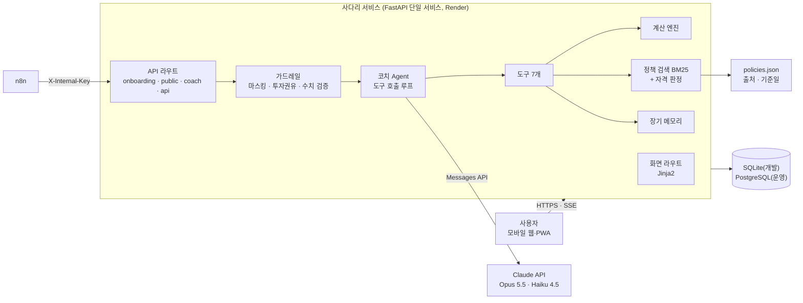
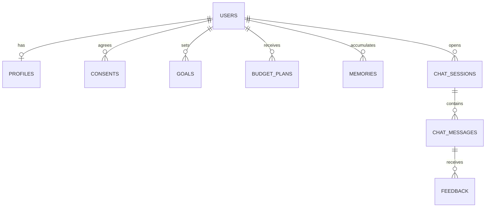

# 사다리 요구사항정의서

> 문서 버전 v1.1 · 작성일 2026-09-30, 수정 2026-10-01 (질문 카드형 진단과 화면 개편 반영) · 관련 문서: [기획안](01_기획안.md) · [상세기획서](02_상세기획서.md) · [AI 활용 설계](04_AI활용설계.md)
> 요구사항 ID(FR-xx, NFR-xx)는 이슈·브랜치·PR·테스트에 그대로 사용해 **기획 → 코드 → 테스트**를 추적합니다.
> 상태: '완료'는 구현과 테스트를 마친 것, '예정'은 괄호 안 이슈에서 구현할 것 ([docs/tasks](tasks/))

## 1. 개요

| 항목 | 내용 |
|---|---|
| 프로젝트명 | 사다리: 청년을 위한 개인별 자산관리 AI 코치 |
| 목적 | 사회초년생이 첫 월급부터 자기 상황에 맞는 자산형성 경로를 설계하고 유지하도록 돕는다 |
| 대상 사용자 | 만 19~34세, 취업 0~3년 차 사회초년생 |
| 범위 | 반응형 웹·PWA, AI 코치, 청년 혜택 매칭, 소비 분석, 주간 체크인 |
| 범위 밖 | 계좌 자동 연동(마이데이터), 개별 투자상품 추천, 금융상품 판매·중개, 네이티브 앱 스토어 출시 |

**우선순위 기준 (MoSCoW)**

- **Must**: MVP에 반드시 포함 (0주 차 구현 완료)
- **Should**: 사용자 테스트 기간(~11/1)에 포함
- **Could**: 여유가 있을 때만 구현

## 2. 기능 요구사항

| ID | 기능명 | 설명 | 우선순위 | 담당 | 상태 | 페인포인트 |
|---|---|---|---|---|---|---|
| FR-01 | 회원가입·로그인 | 이메일·비밀번호 가입, 서명된 세션 쿠키로 로그인 유지 (소셜 로그인은 후속) | Must | 백엔드 | 완료 | - |
| FR-02 | 개인정보 동의 | 필수·선택 동의 분리, AI 처리를 위한 국외 이전 별도 동의, 동의 이력 저장, 설정에서 변경 | Must | 백엔드·PM | 완료 | - |
| FR-03 | 재무 진단 (질문 카드) | 한 화면에 질문 하나씩 나이·일하는 형태·회사 규모·소득·주거·고정비·대출·저축·지역·목표를 묻는다. 답이 정해진 질문은 버튼, 금액은 만 원 단위 입력. 목표 문장만 규칙으로 해석하고 실패하면 LLM이 정리한 뒤 사용자가 확인. 마지막에 전체 답을 보고 고칠 수 있음 | Must | AI Agent·프론트 | 완료 | P1 |
| FR-04 | 재무 프로필 관리 | 설정에서 프로필 수정, 저장 시 플랜 재계산, 진단 다시 하기 | Must | 프론트·백엔드 | 완료 | P1 |
| FR-05 | 월급 배분 플랜 | 계산 엔진이 월세·고정비·대출·생활비·비상금·목표 저축으로 배분하고 AI가 근거를 설명 | Must | 백엔드·AI Agent | 완료 | P1, P4 |
| FR-06 | 목표 설정·시뮬레이션 | 목표 달성 가능성, 일반 적금·청년미래적금 만기액(원금·이자·세금·정부기여금) 계산 | Must | 백엔드 | 완료 | P1 |
| FR-07 | 청년 혜택 매칭 | 프로필로 자격을 판정하고 받을 가능성·예상 수혜액 순으로 제시 | Must | RAG·데이터 | 완료 | P2 |
| FR-08 | 혜택 상세 | 자격 판정 근거, 혜택, 신청 방법·기간, **출처 링크, 기준일** 표시 | Must | RAG·프론트 | 완료 | P2 |
| FR-09 | AI 재무 코치 채팅 | Agent가 도구(계산·검색·조회)로 답변, SSE 스트리밍, 근거 보기, 추천 질문 | Must | AI Agent·프론트 | 완료 | P1~P4 |
| FR-10 | 장기 메모리 | 약속·선호·변화를 저장해 다음 대화에 활용. "AI가 기억하는 나" 조회·삭제 | Must | AI Agent | 완료 | P3 |
| FR-11 | 가드레일·AI 표시 | 민감정보 마스킹, 투자 권유 요청 탐지·출력 차단, 수치 검증, 일일 호출 상한, 'AI 답변' 표시 | Must | AI Agent | 완료 | - |
| FR-22 | 예시 계정·월급 계산기 | 가상 인물 '지우'로 전체 기능 체험(방문자별 분리), 랜딩에서 로그인 없이 월급 배분 계산 | Must | PM | 완료 | - |
| FR-12 | 예·적금 상품 비교 | 금감원 API로 조건에 맞는 상품 금리 비교 (판매 연결 없음) | Should | RAG·데이터 | 예정 DATA-03 | P1 |
| FR-13 | 거래내역 업로드·분류 | 은행·카드 엑셀·CSV 업로드 → 계좌·카드번호 가림 → LLM 컬럼 매핑 → 파싱 → 카테고리 분류, 사용자 수정 | Should | 백엔드·데이터 | 예정 BE-01, DATA-06 | P4 |
| FR-14 | 소비 분석 리포트 | 카테고리별 지출, 고정비·변동비, 구독 등 새는 돈, 저축 여력 | Should | 백엔드·프론트 | 예정 BE-01, FE-02 | P4 |
| FR-15 | 주간 체크인 | 목표 진척·납입 위험·이번 주 실천 1가지를 담은 개인화 리포트 (n8n, 이메일은 선택 동의자만) | Should | RAG·자동화 | 예정 DATA-04 | P3 |
| FR-16 | 목표 대시보드 | 저축 체크인, 목표 진행률, 월별 저축 추이 차트 | Should | 프론트·백엔드 | 예정 FE-01, BE-04 | P3 |
| FR-17 | 답변 피드백 | 좋아요·아쉬워요 평가와 의견 저장(완료). 아쉬워요는 n8n으로 GitHub Issue 자동 생성(예정) | Should | PM | 일부 완료, 예정 PM-02 | - |
| FR-18 | 정책 데이터 자동 갱신 | 온통청년 API 조회 → 신규·변경 반영 → 검색 인덱스 갱신 (n8n 매일) | Should | RAG·자동화 | 예정 DATA-02 | P2 |
| FR-19 | 영수증 인식 | 영수증 사진 → Vision 모델로 날짜·가맹점·금액 추출 → 확인 후 저장 | Should | AI Agent·프론트 | 예정 AI-02, FE-05 | P4 |
| FR-20 | 신규 정책 맞춤 알림 | 새 정책 중 자격이 맞는 사용자에게 알림 | Could | RAG·자동화 | 예정 (DATA-02 이후) | P2 |
| FR-21 | 금융 기초 학습 카드 | 적금·ISA·세액공제 등 핵심 개념 카드와 퀴즈 | Could | PM | 예정 PM-05 | P1 |

### 2.1 Must 기능 인수 기준

| ID | 인수 기준 | 검증 |
|---|---|---|
| FR-03 | 조건부 질문(회사 규모, 월세, 대출 잔액·상환액)은 해당할 때만 묻는다. 금액이 범위를 벗어나면 단위를 확인하라고 안내한다. 연봉과 목표는 건너뛸 수 있다. 목표 문장에서 금액을 찾지 못하면 직접 적는 칸을 보여 준다. 확인 화면에서 항목별로 고칠 수 있다. 테스터 80% 이상이 5분 안에 완료 | `tests/test_onboarding_flow.py`, 사용자 테스트 T1 |
| FR-05 | 같은 입력이면 항상 같은 배분 결과(결정론적). 배분 합계 = 월 실수령액. AI 설명에 계산 결과에 없는 금액이 있으면 템플릿 설명으로 대체 | `tests/test_finance.py` |
| FR-06 | 적금 만기액이 기준 계산기와 비교해 오차 1원 이내(반올림 차이만 허용, 세전 기준). 정부기여금 규칙은 `savings.py`의 상수 한 곳에서 관리하고 출처는 `policies.json`과 연결 | `tests/test_finance.py` |
| FR-07 | 자격에 맞지 않는 정책은 홈 추천에서 제외되고 혜택 목록에서 '해당 없음'으로 분리된다. 모집 기간이 끝났거나 신규 가입이 종료된 정책은 '지금은 신청 불가'. 각 혜택에 출처와 기준일이 있다 | `tests/test_policies.py` |
| FR-09 | 첫 토큰 3초 이내 스트리밍. 정책 질문 답변에는 근거 출처가 첨부된다. 범위 밖 질문은 정중히 안내한다 | `tests/test_app_flow.py`, QA 체크리스트 |
| FR-10 | 이전 대화에서 한 약속·선호가 다음 대화의 시스템 프롬프트에 들어간다. 삭제한 메모리는 다시 쓰이지 않는다 | `tests/test_app_flow.py` |
| FR-11 | 레드팀 프롬프트 30개에서 권유 0건 (현재 10문항 탐지 100%, 30문항 확장은 AI-03). 조사가 붙은 계좌번호도 마스킹. 모든 AI 메시지에 라벨 | `tests/test_guardrails.py`, `eval/run_eval.py` |
| FR-22 | 로그인 없이 예시 계정으로 FR-03~FR-10을 체험할 수 있다. 예시 데이터는 방문자마다 분리. 랜딩 계산기는 아무것도 저장하지 않는다 | `tests/test_app_flow.py` |

## 3. 비기능 요구사항

| ID | 항목 | 요구사항 |
|---|---|---|
| NFR-01 | 성능 | 채팅 첫 토큰 3초 이내(스트리밍), 계산 API 1초 이내, 주요 화면 LCP 2.5초 이내 (무료 플랜 콜드 스타트 제외) |
| NFR-02 | 계산 정확성 | 계산 엔진 단위 테스트 커버리지 90% 이상, 기준 계산기 대비 오차 1원 이내(반올림 차이) |
| NFR-03 | RAG 품질 | 골든셋 40문항 정답률(hit@1) 85% 이상, 근거 포함률 90% 이상 |
| NFR-04 | AI 안전성 | 투자 권유 레드팀 30문항 위반 0건, 근거 없는 금액은 `flagged`로 기록해 검토 |
| NFR-05 | 보안 | HTTPS, 모든 조회에서 로그인 사용자의 소유 여부 확인, scrypt 비밀번호 해시, `HttpOnly`·`SameSite` 세션 쿠키, 보안 헤더, 비밀키는 환경변수(저장소 커밋 금지), 내부 API는 전용 키 |
| NFR-06 | 개인정보 | 실명·계좌번호·카드번호·주민번호 비수집(입력되면 마스킹), 업로드 원본은 저장하지 않음, 탈퇴 시 즉시 삭제, 프로젝트 종료 후 전체 삭제 |
| NFR-07 | 가용성 | 테스트 기간 가동률 95% 이상, `/health` 헬스체크와 외부 모니터링 |
| NFR-08 | 비용 | 사용자별 일일 코치 호출 상한(기본 50회), 경량 작업은 Haiku, 프롬프트 캐싱, 테스트·CI는 모의 모드(비용 0원), 호출별 토큰 기록(AI-05) |
| NFR-09 | 사용성 | 모바일 우선(360px 이상), 데스크톱 2단 배치, PWA 설치 가능, SUS 70점 이상 |
| NFR-10 | 유지보수성 | 계층 분리(라우터·서비스·도구·데이터), ruff, PR 리뷰 필수, CI에서 테스트·AI 평가 자동 실행 |
| NFR-11 | AI 투명성 | 모든 AI 응답에 'AI 답변' 표시, 한계 안내는 코치 화면에 한 번, 근거 링크, 계산 엔진이 낸 금액임을 표시 |
| NFR-12 | 장애 대응 | LLM 호출은 SDK 재시도(최대 2회) 후 이해하기 쉬운 오류 메시지. LLM 추출이 실패하면 규칙 기반으로 대체. 거절 오탐은 서버 측 폴백 |

## 4. AI 활용 명세

| 기능 | AI 방식 | 입력 | 출력 | 모델 | 품질 확보 |
|---|---|---|---|---|---|
| 진단 목표 해석 (FR-03) | 규칙 해석 → 실패 시 구조화 출력 추출 | 목표 문장 | 목표·금액·기간 JSON | Haiku 4.5 | 범위 검증, 사용자 확인 |
| 월급 플랜 설명 (FR-05) | 계산 결과 기반 설명 생성 | 계산 결과 JSON | 3~4문장 설명 | Haiku 4.5 | 근거 없는 금액이면 템플릿 대체 |
| 혜택 매칭 (FR-07·08) | BM25 검색 + 규칙 자격 판정 | 질문, 프로필 | 정책·판정·근거 | (LLM 없음) | 골든셋 평가, 출처 필수 |
| AI 코치 (FR-09) | 스트리밍 도구 호출 Agent (최대 6턴) | 질문, 최근 12턴, 기억 10개 | 답변 + 근거 | Opus 5.5 (effort medium) | 수치 검증, 출력 가드레일, 루브릭 채점(AI-04) |
| 장기 메모리 (FR-10) | 대화 후 구조화 추출 | 질문·답변 | 메모리 0~2개 | Haiku 4.5 | 중복 제거, 사용자 조회·삭제 |
| 가드레일 (FR-11) | 규칙 기반 입력·출력 검사 + 프롬프트 원칙 | 질문, 응답 | 통과·교체·표시 | (규칙) | 레드팀 평가 |
| 거래 분류 (FR-13) | 컬럼 매핑 + 배치 분류 | 가린 앞 20행, 가맹점명 | 매핑·카테고리 JSON | Haiku 4.5 | 사용자 수정 (예정 DATA-06) |
| 영수증 인식 (FR-19) | Vision + 구조화 출력 | 영수증 이미지 | 날짜·가맹점·금액 JSON | Haiku 4.5 | 사용자 확인 단계 (예정 AI-02) |
| 주간 체크인 (FR-15) | 개인화 생성 | 진척·약속 요약 | 리포트 본문 | Haiku 4.5 | 수치 대조 (예정 DATA-04) |

## 5. 시스템 아키텍처

| 계층 | 위치 | 역할 |
|---|---|---|
| 라우터 | `app/routers/` | 화면과 API 입출력, 로그인·동의·진단 완료 여부 확인 |
| 서비스 | `app/services/` | 계산 엔진(finance), 정책 검색·자격 판정(policies), 코치 Agent·가드레일·메모리(agent), 진단 질문(onboarding) |
| 데이터 | `app/models.py`, `app/data/` | SQLAlchemy 모델, 정책 시드 데이터 |
| 화면 | `app/templates/`, `app/static/` | 서버 렌더링 화면, 진단 카드·계산기·채팅 스트리밍 JS |

자세한 흐름(인증, 외부 연동, n8n 워크플로우)은 [상세기획서 7장](02_상세기획서.md#7-시스템-아키텍처)에 있습니다.

## 6. 데이터 모델

| 테이블 | 주요 컬럼 | 상태 |
|---|---|---|
| users | id, email, password_hash, nickname, is_demo, created_at | 완료 |
| profiles | user_id, age, region, employment_type, company_size, monthly_income, annual_income, housing_type, rent, fixed_costs, debt_total, debt_monthly, savings, goal_text, goal_amount, goal_months, onboarding_done | 완료 |
| consents | id, user_id, kind(terms·privacy·overseas·weekly_email), agreed, version, created_at | 완료 |
| goals | id, user_id, name, target_amount, target_months, monthly_needed | 완료 |
| budget_plans | id, user_id, allocations(JSON), summary(JSON), notes(JSON), explanation, explanation_by_ai, rule_version | 완료 |
| chat_sessions | id, user_id, kind(coach), state(JSON) | 완료 |
| chat_messages | id, session_id, user_id, role, content, sources(JSON), tools_used(JSON), flagged | 완료 |
| memories | id, user_id, kind(preference·commitment·fact), content | 완료 |
| feedback | id, user_id, message_id, rating, comment | 완료 |
| transactions | id, user_id, date, amount, merchant, category, is_fixed, source | 예정 BE-01 |
| savings_logs | id, user_id, month, amount, memo | 예정 BE-04 |

- **정책 데이터**는 DB가 아니라 `app/data/policies.json`(출처·기준일 포함)에 두고, 시작 시 BM25 인덱스를 메모리에 만든다. 온통청년 연동(DATA-02) 이후 DB 이전을 검토한다.

## 7. 화면·API 명세

**화면** (서버 렌더링): `/` 랜딩 · `/signup` `/login` · `/consent` · `/onboarding` · `/home` · `/plan` · `/benefits` · `/benefits/{policy_id}` · `/coach` · `/settings` · `/privacy` `/terms`

| 메서드 | 경로 | 설명 | 관련 FR | 상태 |
|---|---|---|---|---|
| POST | `/signup`, `/login`, `/logout`, `/consent` | 가입·로그인·동의 (폼) | FR-01·02 | 완료 |
| POST | `/demo` | 예시 계정 생성·로그인 | FR-22 | 완료 |
| POST | `/api/public/quick-plan` | 로그인 없이 월급 배분 계산 (저장하지 않음) | FR-22 | 완료 |
| GET | `/api/onboarding/questions` | 질문 카드 정의와 기존 답(다시 진단할 때) | FR-03 | 완료 |
| POST | `/api/onboarding/parse-goal` | 목표 문장 → 금액·기간 | FR-03 | 완료 |
| POST | `/api/onboarding/complete` | 전체 답 검증 → 프로필·목표·플랜 생성 | FR-03 | 완료 |
| PUT | `/api/profile` | 프로필 수정 → 플랜 재계산 | FR-04 | 완료 |
| POST | `/api/plans/generate` | 플랜 재계산 | FR-05 | 완료 |
| POST | `/api/goals/simulate` | 적금·청년미래적금 시뮬레이션 | FR-06 | 완료 |
| POST | `/api/coach/chat` | AI 코치 대화 (SSE: status·delta·replace·notice·done·error) | FR-09 | 완료 |
| DELETE | `/api/memories/{id}` | 기억 삭제 | FR-10 | 완료 |
| POST | `/api/feedback` | 답변 평가 | FR-17 | 완료 |
| DELETE | `/api/account` | 탈퇴 (전체 삭제) | NFR-06 | 완료 |
| GET | `/internal/ping` | 자동화 연결 확인 (`X-Internal-Key`) | - | 완료 |
| GET | `/health` | 헬스체크 | NFR-07 | 완료 |
| POST | `/api/transactions/upload`, GET `/api/transactions/summary` | 거래내역 분석 | FR-13·14 | 예정 BE-01 |
| PUT | `/api/savings/{month}`, GET `/api/savings` | 저축 기록 | FR-16 | 예정 BE-04 |
| POST | `/api/receipts/scan` | 영수증 인식 | FR-19 | 예정 AI-02 |
| POST | `/internal/policies/ingest` | 정책 데이터 수집 | FR-18 | 예정 DATA-02 |
| POST | `/internal/reports/weekly` | 주간 리포트 생성 | FR-15 | 예정 DATA-04 |

개발 환경에서는 `/api/docs`에서 API 문서(OpenAPI)를 볼 수 있다.

## 8. 외부 연동

| 연동 대상 | 용도 | 인증 | 장애 시 대응 | 상태 |
|---|---|---|---|---|
| Claude API | 코치 Agent·추출·설명·Vision | API 키 (서버 환경변수) | SDK 재시도 후 안내 메시지, 추출은 규칙으로 대체 | 완료 (키 연결은 AI-01) |
| Render | 호스팅·PostgreSQL | 대시보드 | 이전 배포로 롤백 | 예정 배포 |
| 온통청년 Open API | 청년정책 데이터 | 인증키 (회원가입 후 발급) | 마지막 수집본 사용 | 예정 DATA-02 |
| 금감원 금융상품한눈에 Open API | 예·적금 상품 | 인증키 | 일일 캐시 사용 | 예정 DATA-03 |
| 이메일 발송 (Gmail 등) | 주간 체크인 | n8n 자격 증명 | 발송 실패 로그·재발송 | 예정 DATA-04 |
| GitHub API | 피드백 → Issue | 토큰 (n8n) | 실패 시 디스코드 알림 | 예정 PM-02 |
