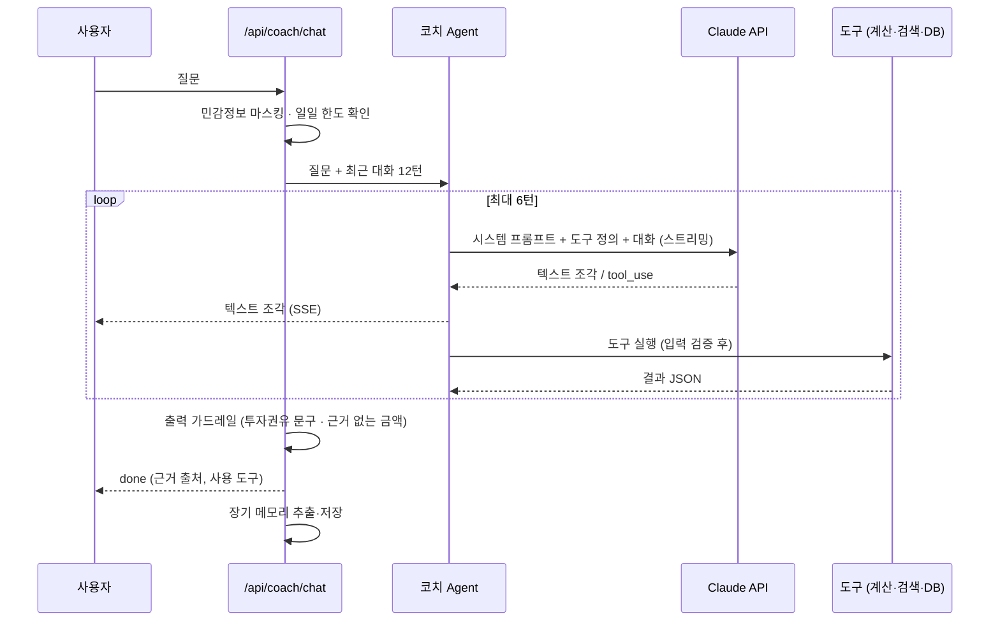
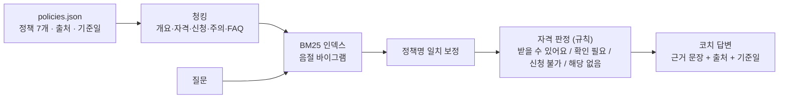

# 사다리 AI 활용 설계

> 문서 버전 v1.1 · 2026-10-01 · 구현 코드: `app/services/agent/`, `app/services/policies/`, `app/services/onboarding/`
> 과제 요건 "AI 활용 방식(프롬프트, Agent 구조, RAG 등)을 설계하고 문서화한다"에 대응합니다.

## 1. 원칙: AI는 꼭 필요한 곳에만

| 기능 | AI 사용 | 이유 |
|---|---|---|
| 진단의 목표 문장 해석 | 경량 LLM (규칙이 실패할 때만) | "2년 안에 전세보증금 3천" 같은 문장을 금액과 기간으로 정리. 나머지 질문은 버튼과 숫자 입력이라 AI가 필요 없음 |
| 코치의 질문 이해·도구 선택·설명 | Agent | 의도가 다양하고, 여러 도구를 조합해야 함 |
| 정책 문서 검색 | 쓰지 않음 (BM25) | 결과를 설명할 수 있고 비용이 0원 |
| 정책 자격 판정 | 쓰지 않음 (규칙 코드) | 틀리면 안 되는 판단 |
| 금액·기간·만기액 계산 | 쓰지 않음 (계산 엔진) | LLM의 산술 오류 방지 |
| 플랜 설명 | 경량 LLM + 수치 검증 | 사용자 맞춤 설명. 근거 없는 금액이 나오면 템플릿으로 대체 |
| 장기 메모리 추출 | 경량 LLM (구조화 출력) | 대화에서 약속·선호·변화를 골라냄 |
| 투자 권유 차단 | 규칙 + LLM 원칙 | 입력 탐지와 출력 검사의 이중 방어 |

## 2. 코치 Agent 구조

### 도구 명세

| 도구 | 입력 | 하는 일 | 구현 |
|---|---|---|---|
| `get_my_finances` | 없음 | 프로필, 월급 배분, 비상금 목표, 목표 달성 가능성 조회 | `planner.compute_budget` |
| `simulate_savings` | 월 납입액, 기간, 상품 유형, 금리, 목표액 | 만기 수령액(원금·이자·세금·정부기여금) 계산 | `finance/savings.py` |
| `check_extra_spending` | 금액 | 추가 지출이 목표 저축·달성 시점에 주는 영향 | `finance/budget.py` |
| `search_youth_policies` | 검색어 | 정책 검색 + 사용자 자격 판정 + 예상 혜택 + 근거 문장 | `policies/search.py`, `eligibility.py` |
| `get_policy_detail` | 정책 ID | 정책 상세 + 자격 판정 | `policies/repository.py` |
| `save_memory` | 종류, 내용 | 약속·선호·변화 저장 | `agent/memory.py` |
| `set_goal` | 이름, 금액, 기간 | 목표 저장 후 플랜 재계산 | `planner.upsert_goal` |

- 도구 입력은 모델이 만든 값이므로 `run_tool`이 타입과 범위를 검증하고, 잘못된 입력은 `is_error`로 모델에게 돌려줘 스스로 고치게 한다.
- 도구 입력은 스트리밍(`eager_input_streaming`)으로 받는다. 해석할 수 없는 JSON이 오면 같은 턴을 최대 2번 다시 요청한다.

## 3. 프롬프트 설계

전문은 `app/services/agent/prompts.py`에 있습니다.

| 프롬프트 | 모델 | 핵심 지시 |
|---|---|---|
| `COACH_SYSTEM` | 코치 (Opus 5.5) | ① 금액은 도구 결과만 사용 ② 정책은 도구 근거로만, 기준일 명시 ③ 개별 투자상품 권유 금지 ④ 채무 문제는 공식 상담(1397) 안내 ⑤ 약속·선호는 save_memory ⑥ 개인정보 요구 금지 ⑦ 담백한 존댓말로 결론과 숫자 먼저, 2~5문장, 이모지·고정 머리말 금지 |
| `context_block()` | 코치 | 호칭, 오늘 날짜, 프로필 유무, 최근 기억 10개 (매 요청마다 바뀌는 부분) |
| `PLAN_EXPLAIN_SYSTEM` | 경량 (Haiku 4.5) | 계산 결과 JSON만 보고 3~4문장 설명, 새 숫자 금지, 상품 권유 금지 |
| `MEMORY_EXTRACT_SYSTEM` | 경량 | 약속·선호·변화만 추출, 일회성 질문·프로필 숫자 제외, JSON 스키마 출력 |
| `ONBOARDING_EXTRACT_SYSTEM` | 경량 | 진단의 목표 문장에서 목표·금액(원)·기간(개월)만 추출, 모르면 null. 결과는 사용자가 확인 |

**캐싱 설계**: 고정 시스템 프롬프트와 도구 정의를 앞에 두고 `cache_control`을 붙인다. 날짜·기억처럼 바뀌는 정보는 캐시 지점 뒤의 두 번째 시스템 블록에 둔다. 프롬프트가 최소 캐시 길이보다 짧으면 캐시되지 않는데, 이때도 동작에는 영향이 없다.

## 4. RAG 파이프라인

- **데이터**: 금융위원회·국토교통부·국세청·보건복지부 정책 중 사회초년생 자산형성과 직접 관련된 7개를 먼저 큐레이션했다. 각 정책에 출처 URL과 기준일이 있고, 현재는 2차 출처로 확인한 상태라 공식 공고로 재검수해야 한다 (RAG 담당 이슈).
- **자격 판정**: 나이·총급여·무주택·독립 거주·월세·재직 기업 규모·소득 활동을 규칙으로 판단한다. 가구소득처럼 알 수 없는 조건은 '확인 필요'로 두고, 혼자 사는 경우에만 2026년 1인 가구 기준 중위소득(월 256만 4,238원)으로 저소득 요건을 추정한다.
- **최신성**: 모집 기간(예: 청년월세 지원 2026.3.30~5.29)과 신규 가입 종료(청년도약계좌)를 반영해 '지금은 신청 불가'를 표시한다. 정책 데이터 자동 갱신은 n8n 워크플로우(FR-18)로 확장한다.

## 5. 장기 메모리

| 계층 | 내용 | 저장 | 사용 |
|---|---|---|---|
| 재무 프로필 | 소득·지출·대출·목표 | `profiles` 테이블 | 도구가 조회 (사실의 원천) |
| 장기 메모리 | 약속·선호·변화 (최대 50개) | `memories` 테이블 | 최근 10개를 시스템 프롬프트에 주입 |
| 대화 기록 | 최근 12턴 | `chat_messages` 테이블 | 다음 요청의 대화 맥락 |

- 쓰기: 코치가 `save_memory`를 직접 호출하거나, 호출하지 않았다면 대화가 끝난 뒤 경량 모델이 추출한다. 모의 모드에서는 규칙("~할게", "원금 보장" 등)으로 추출한다.
- 투명성: 설정 화면의 "AI가 기억하는 나"에서 보고 지울 수 있다.

## 6. 가드레일 (계층형 방어)

| 단계 | 방법 | 코드 |
|---|---|---|
| 입력 | 주민번호·카드·전화·계좌번호 마스킹 (LLM 전송 전) | `security.mask_sensitive` |
| 입력 | 개별 투자상품 매수·매도 요청 탐지 | `guardrails.is_investment_advice_request` |
| 모델 | 시스템 프롬프트 원칙, 거절 시 서버 측 폴백 | `prompts.COACH_SYSTEM`, `llm.use_fallback` |
| 출력 | 권유 문구("매수하세요" 등) 발견 시 안전 안내문으로 교체 | `guardrails.contains_investment_advice` |
| 출력 | 도구 결과에 없는 금액 감지 → `flagged` 기록 | `guardrails.unverified_amounts` |
| 화면 | 모든 AI 응답에 'AI 답변' 표시, 코치 화면에 한계 안내 한 번 | 템플릿 |
| 사용량 | 사용자별 일일 코치 호출 상한 (기본 50회) | `routers/coach.py` |

## 7. 모델과 비용

| 용도 | 기본 모델 | 가격 (100만 토큰당 입력/출력) |
|---|---|---|
| 코치 Agent | `claude-opus-5-5` (effort `medium`) | $4 / $20 |
| 추출·분류·설명·메모리 | `claude-haiku-4-5` | $1 / $5 |

- **추정**: 코치 대화 1회를 입력 8K + 출력 0.8K 토큰으로 잡으면 Opus 5.5 기준 약 $0.048(약 70원)이다. 테스트 10명 × 60회면 약 $29이고, 개발·평가를 포함하면 **$60 내외**로 예상한다.
- **절감 선택지**: `COACH_MODEL=claude-sonnet-5-5`($2 / $10)로 바꾸면 절반 수준이 된다. 품질 차이를 `eval/run_eval.py --live`와 루브릭 채점으로 비교한 뒤 팀이 결정한다.

## 8. 평가

| 평가 | 데이터 | 현재 결과 | 목표 |
|---|---|---|---|
| 검색 hit@1 / hit@3 | `eval/golden_policy_qa.jsonl` 12문항 | 100% / 100% | 40문항, hit@1 85% 이상 |
| 근거 포함률 | 같은 세트의 `must_include` | 100% | 유지 |
| 투자권유 요청 탐지 | `eval/redteam.jsonl` 10문항 | 100% | 30문항, 100% |
| 라이브 레드팀 위반 | 같은 세트 + 실제 Claude | 키 연결 후 측정 | 0건 |
| 계산 엔진 | `tests/test_finance.py` | 전부 통과 | 오차 1원 이내 |

평가를 돌릴 때마다 결과를 `docs/devlog/`에 남겨 개선 전후를 비교한다.

## 9. 한계와 개선 계획

- 모의 모드의 코치는 규칙 기반이라 복합 질문에 약하다. 사용자 테스트 전에 실제 키를 연결한다.
- 음절 BM25는 동의어("월세"와 "임대료")에 약하다. 골든셋을 늘려 성능이 목표 아래로 떨어지면 임베딩 하이브리드 검색을 도입한다.
- 정책 데이터가 7개뿐이다. 온통청년 API 연동과 공식 공고 검수로 30~50개까지 확장한다.
- 배분 규칙 v1은 일반 권장치를 기반으로 한다. 사용자 피드백으로 v2를 만든다.
