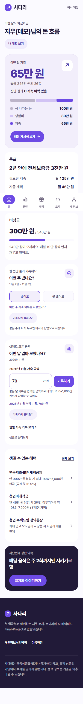
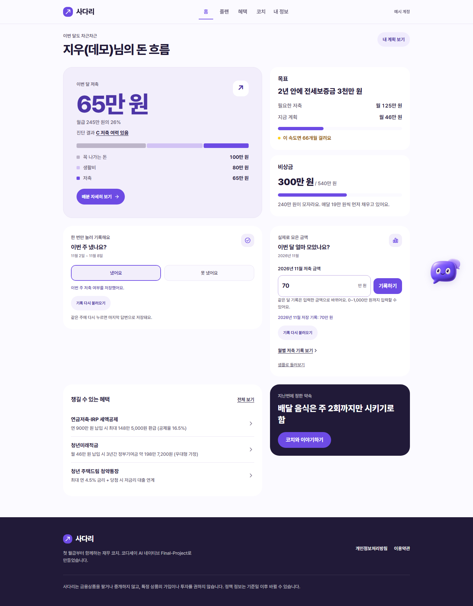
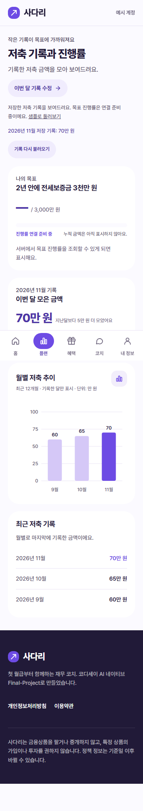
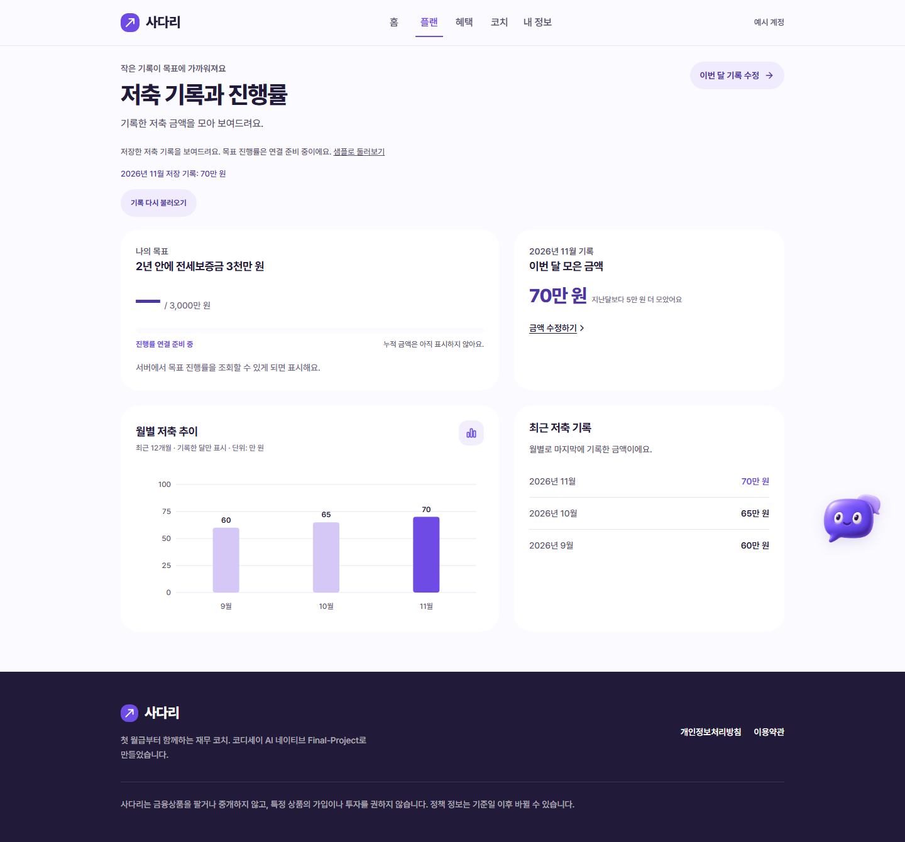

# FE-01: 주간 체크·월 저축 저장과 기록 조회 연결

브랜치 `feature/FE-01-weekly-check` · 기존 Draft PR #52 · Refs #14, #22, #62.

## 연결한 범위

기존 보라색 UI와 홈 카드의 7/5 열 배치를 유지하면서 기본 `/home`·`/progress`에 실제 저장·조회 어댑터를 연결했다. 기존 플랜·계산·시뮬레이션·진단·코치 기능은 변경하지 않는다.

현재 BE-04 `8b0fc1742c2c89eb3f326a1d1d1a36f3ca5005ee`의 계약을 사용한다.

| 기능 | 요청 |
| --- | --- |
| 주간 조회 | `GET /api/checkins` |
| 주간 저장 | `PUT /api/savings/weekly-check`, JSON `week`, `paid` |
| 월별 조회 | `GET /api/savings` |
| 월 저축 저장 | `POST /api/savings/monthly`, JSON `month`, 원 단위 정수 `amount` |

- 쿠키 인증·같은 출처 요청과 `no-store` 조회를 사용한다. 프론트에 API 키를 넣거나 실제 기록을 localStorage/sessionStorage에 저장하지 않는다.
- 주간 조회의 `deposited`와 저장의 `paid`를 같은 `paid`로 다룬다. 미납 `false`를 미기록과 구분하며 못 냈다는 기록이 있으면 기존 코치 링크를 보여 준다. 서버가 조회 필드를 `paid`로 통일해도 받을 수 있다.
- 화면의 만 원 단위를 유지한다. 소수점 4자리까지 정수 원으로 정확히 바꾸며 현재 서버 상한 1,000만 원을 넘지 않게 한다. 예: 1.2345만 원 → 12,345원. 0원도 유효한 기록이다.
- 같은 주·달 수정은 해당 기간 값을 덮어쓴다. 저장 응답의 기간과 값이 요청과 일치하는지 검사하고 새로고침·화면 이동 후 서버 조회로 기록을 복원한다.
- 최근 12개월에 실제 기록한 달만 차트·목록에 표시한다. 미기록을 0원으로 채우지 않고 이번 달·지난달 기록이 모두 있을 때만 증감을 비교한다. SVG 색·서체·왼쪽부터 순차 상승·동작 줄이기를 유지한다.
- 조회·저장 중 중복 요청을 막고, 재조회가 입력 중인 금액을 덮어쓰지 않게 한다. 주간·월별 오류를 분리한다. API 준비 전 404, 인증/동의/진단, 입력·서버·JSON·네트워크 오류, 20초 시간 제한을 안내한다. 저장 결과를 확인하지 못하면 재조회로 확인하며 성공으로 바꾸지 않는다.
- 페이지 이탈 시 요청을 취소하고 이전 응답의 화면 반영을 막는다. 뒤로/앞으로 캐시 복원 시 서버 렌더링 계정·기간 정보도 다시 받아 이전 계정·기간의 화면을 재사용하지 않는다.
- 샘플은 `/home?example=sample`, `/progress?example=sample`로 명시적으로 선택한다. 샘플 간 링크와 사용자별 sessionStorage 체험은 유지하며 실제 API를 호출하지 않는다.

## 남은 범위와 의존성

`GET /api/savings`에 `progress`가 없다. 실제 목표 카드에는 실제 목표명·목표액과 ‘진행률 연결 준비 중’을 표시한다. 최근 12개월 합계를 누적 자산으로 쓰거나 월 저축 저장 응답의 진행률만 일시적으로 표시하지 않는다.

PR #62의 저장 경로 최종 합의, 주간 조회 필드 통일, 서버의 최근 8주·12개월 범위 및 누적 진행률 조회는 리뷰 보완 대기다. 해당 응답이 준비되면 진행률을 후속 연결한다. FE-01 전체나 #14를 완료 처리하지 않는다.

BE-04 PR #62는 검증 시점 미병합이다. FE-01만 pull하면 백엔드 API가 추가·배포되지 않는다. BE-04 코드가 포함된 같은 출처 실행 환경이 필요하다. 검증에는 FE-01과 위 고정 SHA를 별도 임시 디렉터리에서 조합했다. 검증용 백엔드 코드·DB·도구는 FE-01 PR에 넣지 않는다.

## 검증

- FE-01: pytest 110개, Node 계약·샘플 회귀 22개, Ruff·JS 구문·diff 검사 통과.
- BE-04와 별도 로컬 조합: pytest 115개 통과. AI는 mock 모드, 사용자·기록은 모두 가짜다.
- Chromium 360px·1440px: 70개 통과. 실제 true/false·월 금액 저장, 같은 달 수정, 새로고침·이동 후 조회, 0원·원 단위 정밀도, 잘못된 입력, 입력 중 재조회, 월별 범위·증감·차트 효과, 진행률 미표시, 저장 실패·응답 유실 후 재조회, 샘플 미전송, 다른 계정 분리, 기존 플랜을 확인했다.
- 추가 320px·동작 줄이기: 19개 통과. 인증/동의/진단·404·서버·JSON·네트워크 실패, 부분 기능 오류 분리, 실제 기록 비캐시, 중복 제출 방지, 상한 금액, 실제 세션 만료 시 기록 비우기를 확인했다.
- 브라우저 확인 총 89개, JS 오류 0. FE-01 외 기능으로 변경 요청을 보내지 않았다.
- 운영 배포 및 iOS Safari·Android Chrome 실기기 확인은 남아 있다.

## 실제 앱 캡처

샘플 UI 모드가 아니라 로컬 BE-04 API에 가짜 기록을 저장한 결과다.

Codex로 어댑터·화면 연결·검사를 작성했다. 실제 저장·샘플·미기록·진행률 미연결을 구분하고 기존 보라색 UI 보존을 검토했다. 작성자·커미터와 GitHub 인증 계정은 hyoryeomii를 사용한다. main·다른 FE 브랜치를 수정하지 않고 PR #52는 Draft로 유지한다.
