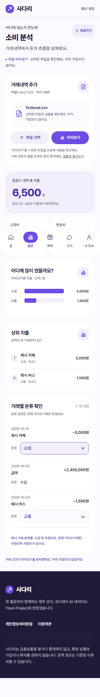
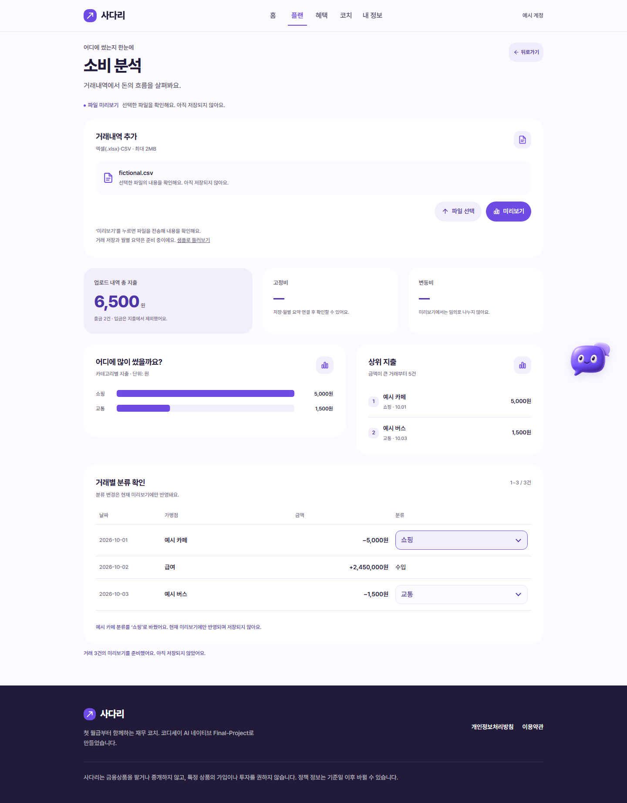
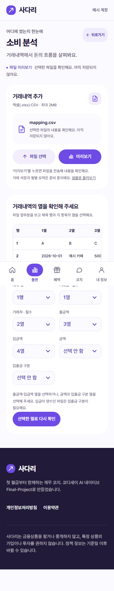
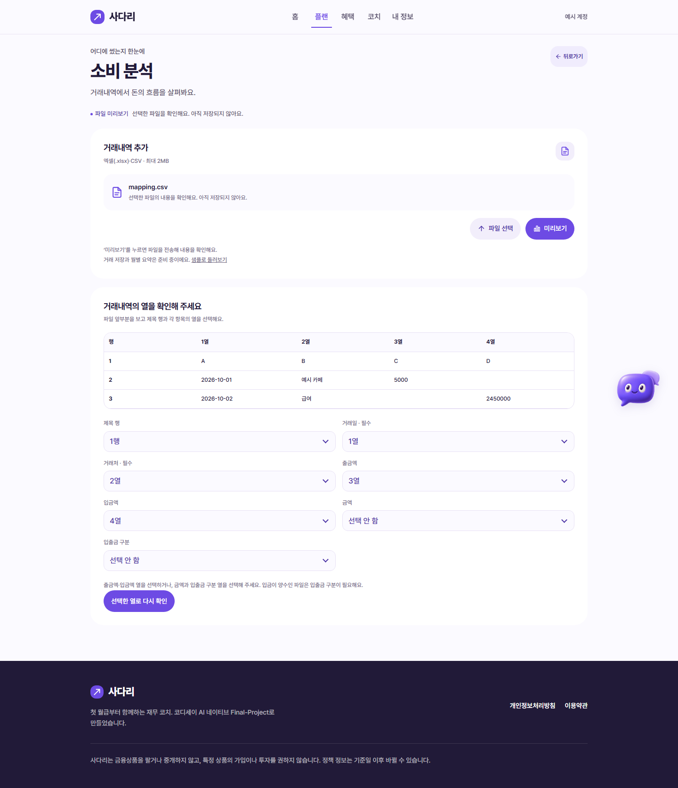

# FE-02: DATA-06 파일 미리보기 API 연결

브랜치 `codex/FE-02-spending` · 기존 Draft PR #54 · Refs #15, #37.

## 동작

기본 `/spending`에서 CSV/XLSX를 선택한 뒤 ‘미리보기’를 누르면 같은 출처의 `POST /api/transactions/preview`에 multipart `file`을 보낸다. 파일 선택만으로는 업로드하지 않는다. 쿠키 인증을 사용하며 Content-Type 경계값은 브라우저에 맡긴다.

- 정상 응답: 출금은 양수 표시용 값으로 바꿔 카테고리 차트·상위 지출에 반영한다. 입금은 지출 합계에서 제외하고 부호를 붙여 거래 목록에 표시한다. 특정 월의 요약으로 오해하지 않게 ‘업로드 내역 총 지출’이라고 표시한다.
- 열 선택: 가림 처리된 앞 20행을 보고 제목 행·거래일·거래처·금액 열을 고른다. 필수 항목·중복 열·제목 행에 없는 열을 확인한 뒤 같은 파일과 `mapping` JSON 문자열, `header_row`를 다시 보낸다. 화면의 1행/1열 표시는 요청에서 0부터 시작하는 번호로 변환한다.
- 부분 오류: 정상·오류 건수와 파일 기준 오류 행 번호를 보여 준다. ‘정상 거래 미리보기’를 눌러야 결과에 들어가며 정상 거래가 없으면 해당 버튼을 비활성화한다.
- 빈 결과, 손상된 파일, 형식·크기 오류, 401/403/409, API 준비 전 404, 서버 오류, JSON 응답 오류, 네트워크 오류, 60초 시간 제한을 성공 결과와 구분한다. 재시도는 선택 파일과 열 선택을 유지한다.
- 새 파일을 선택하거나 페이지를 떠나면 요청을 취소한다. 이전 응답이 나중에 도착해도 새 파일 화면을 덮어쓰지 않는다.
- 고정비·변동비는 아직 알 수 없으므로 `—`로 표시한다. 분류 선택은 기존 보라색 메뉴로 유지하되 현재 미리보기만 바꾸고 저장하지 않는다. 20건씩 표시하는 행을 재사용해 최대 10,000건의 메뉴를 한꺼번에 만들지 않는다.
- 기존 샘플은 `/spending?example=result`에서 사용할 수 있다. 이 모드에서 선택한 파일은 계속 읽거나 전송하지 않는다. 기존 제목·버튼·카드·색·차트 순차 등장·플랜 복귀 효과를 유지한다.

## 의존성과 남은 범위

[DATA-06 PR #56](https://github.com/PSHUN03/Codyssey-M3-1/pull/56)의 미리보기 API는 검증 시점에 미병합이었다. 해당 백엔드가 포함된 같은 출처의 실행 환경이 필요하다. FE-02 브랜치만 받았다고 API가 함께 생기거나 배포되는 것은 아니다.

검증에는 PR #56의 `ab7546eb350edcf4e0e91e3e27632c1ec8771250`과 현재 FE-02를 Git 브랜치 변경·병합 없이 별도 임시 디렉터리에서 조합했다. `openpyxl`도 그 검증 디렉터리에만 설치했다. 검증용 백엔드 코드·DB·모의 파일은 FE-02 PR에 추가하지 않는다.

BE-01 저장·월별 요약·분류 수정의 경로와 요청·응답은 [담당자 답변](https://github.com/PSHUN03/Codyssey-M3-1/issues/15#issuecomment-6618934609) 이후 확정 대기다. 현재는 미리보기이며 거래 저장, 구독 후보 확정, 서버 분류 수정, 실제 LLM 분류 품질, 배포·iOS/Android 실기기 확인은 완료 범위에 포함하지 않는다.

## 검증

- FE-02: `ruff check .`, JS 구문, `git diff --check`; pytest 108개, Node 26개 통과.
- DATA-06과의 별도 로컬 조합: pytest 127개 통과. AI는 mock 모드이고 거래 데이터는 모두 가짜다.
- 실제 Chromium 360px·1440px: 86개 확인 통과. 실제 CSV 2종·XLSX, 수동 열 선택 재요청, 부분 오류 확인·전체 오류·빈 결과·입금만 있는 결과, 20건 페이지 이동, 분류 메뉴, 샘플 미전송, 인증·오류·재시도, 기존 플랜·설정 화면을 확인했다.
- 추가 320px 일반/동작 줄이기: 14개 확인 통과. 이전 응답 무시, 긴 거래처와 최대 행 금액, HTML 문자열 이스케이프, 키보드 분류 선택, 실제 세션 만료를 확인했다.
- 전체 브라우저 확인 100개, JS 오류 0. 미리보기 외 거래 저장·요약·분류 수정 요청 0.

## 실제 앱 화면

모바일과 PC 모두 기존 보라색 테마에서 촬영했다. 아래 결과는 샘플 UI 모드가 아니라 가짜 CSV를 실제 DATA-06 API에 전송한 로컬 미리보기다. 파일 이름·거래 정보는 검증용이다.

Codex로 FE 연결·오류 처리·검사를 작성했다. 사용자의 기존 보라색 UI와 샘플 체험을 보존하고, 미리보기와 DB 저장을 구분해 검토했다. main과 다른 FE 작업 브랜치를 수정하지 않는다. PR은 Draft로 유지한다.
