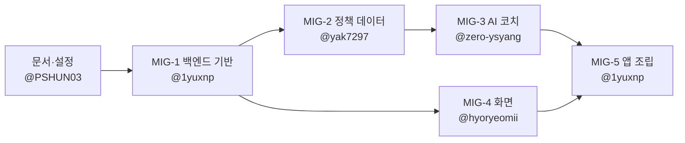

# MVP 코드 이관 안내

## 왜 이관하나요

MVP는 2026-09-30부터 10-22까지 팀장 @PSHUN03이 Claude Code와 페어 프로그래밍으로 만들었습니다. 새 저장소에서는 이 코드를 **각 모듈의 담당자가 직접 읽고 테스트한 뒤 PR로 옮깁니다.** 그래야 담당자가 자기 모듈을 설명하고 이어서 개발할 수 있습니다.

- 이관 커밋에는 원작성자(@PSHUN03, Claude)를 `Co-authored-by`로 남깁니다. 이관 PR은 "처음부터 작성했다"가 아니라 "검토하고 넘겨받았다"는 기록입니다.
- 각자의 실제 기여는 이관 이후의 기능 개발 커밋, 리뷰, 이슈로 남깁니다 ([docs/tasks](tasks)).
- 이관 PR에서는 코드를 고치지 않습니다. 고치고 싶은 점은 PR 본문에 적어 두고, 머지 후 별도 이슈·PR로 고칩니다. 원본과 개선을 구분하기 위해서입니다.

## 순서



| 단계 | 담당 | 내용 | 먼저 머지 | 리뷰어 |
|---|---|---|---|---|
| MIG-1 | @1yuxnp | 백엔드 기반과 계산 엔진 (파일 16개) | 없음 | @hyoryeomii |
| MIG-2 | @yak7297 | 정책 데이터와 검색·자격 판정 (파일 8개) | MIG-1 | @zero-ysyang |
| MIG-3 | @zero-ysyang | AI 코치 Agent·가드레일·메모리 (파일 15개) | MIG-2 | @yak7297 |
| MIG-4 | @hyoryeomii | 화면·디자인 시스템·진단 질문 카드 (파일 28개) | MIG-1 | @1yuxnp |
| MIG-5 | @1yuxnp | 라우터·인증·앱 조립과 통합 테스트 (파일 11개) | MIG-3, MIG-4 | @hyoryeomii |

- MIG-4(화면)는 MIG-1이 머지되면 바로 시작할 수 있어 MIG-2·MIG-3과 동시에 진행합니다.
- **MIG-5가 머지되기 전까지 앱은 실행되지 않습니다.** 10/31(토) 하루 안에 다섯 단계를 모두 머지합니다 (MIG-1 10시, MIG-2·MIG-4 14시, MIG-3 18시, MIG-5 22시). 이날은 리뷰 요청을 받으면 1시간 안에 봐 주세요. 막히면 바로 디스코드에 알려 주세요.
- 리뷰어는 [협업 규칙](../CONTRIBUTING.md)의 리뷰 짝입니다. MIG-5는 앱 전체가 처음 돌아가는 단계라 팀장도 함께 확인합니다.

## 준비 (처음 한 번)

1. [협업 규칙의 "처음 참여할 때"](../CONTRIBUTING.md#0-처음-참여할-때) 1~4를 따라 초대 수락, 이메일 비공개 설정, 내려받기, git 설정, 가상환경 설치(`pip install -r requirements-dev.txt`)를 합니다.
2. 팀장에게 디스코드로 **`sadari-mvp-source.zip`**(이전 MVP 소스 묶음)을 받습니다. 압축을 풀지 않아도 되고, 이 파일은 저장소에 올리지 않습니다.

## 이관하기 (각 담당자)

예시는 MIG-1입니다. 자기 단계 번호로 바꿔서 실행하세요.

```bash
git switch main
git pull
git switch -c migrate/MIG-1
python scripts/take_over.py MIG-1 --source 경로/sadari-mvp-source.zip
```

스크립트가 자기 단계의 파일만 옮기고 커밋 메시지를 준비한 뒤 다음 명령을 알려 줍니다. 앞 단계가 아직 머지되지 않았으면 멈추고 알려 줍니다.

```bash
ruff check .
pytest -q
git add app tests                          # 스크립트가 알려 주는 폴더
git commit -F .git/MIG-1_COMMIT_MSG        # 스크립트가 알려 주는 경로
git push -u origin migrate/MIG-1
```

그다음 GitHub에서 PR을 엽니다.

- base는 `main`, 제목은 `[MIG-1] 백엔드 기반과 계산 엔진 이관`
- 본문은 아래 양식으로 쓰고, 리뷰어를 지정합니다
- 커밋 메시지의 `Co-authored-by` 줄은 지우지 않습니다

## 이관 PR 본문 양식

```markdown
## 무엇을 옮겼나요
- [MIG-1] 백엔드 기반과 계산 엔진, 파일 16개 (docs/migration.md 목록 그대로)
- Closes #이슈번호

## 이 모듈이 하는 일
<!-- 읽고 이해한 내용을 자기 말로 3~5줄. 발표 질의응답 준비가 됩니다 -->

## 확인한 것
- [ ] `ruff check .`, `pytest -q` 통과 (결과 마지막 줄을 붙여 주세요)
- [ ] 직접 따라가 본 함수:

## 궁금한 점, 고치고 싶은 점
<!-- 머지 후 이슈로 만듭니다 -->

## 출처
이전 저장소의 MVP 코드(@PSHUN03, Claude Code와 페어 프로그래밍). 커밋에 공동 작성자로 표시했습니다.
```

## 리뷰어가 볼 것

- CI가 통과했는지, 파일이 아래 목록과 같은지 (스크립트로 옮겼다면 같습니다)
- "이 모듈이 하는 일" 설명이 코드와 맞는지. 질문이나 의견을 댓글로 하나 이상 남깁니다
- 승인 후 PR 작성자가 "Create a merge commit"으로 머지합니다

## 단계별 파일 목록

### MIG-1 백엔드 기반과 계산 엔진 (@1yuxnp)

먼저 머지: 없음 · 리뷰어: @hyoryeomii

- `app/__init__.py`
- `app/config.py`
- `app/db.py`
- `app/models.py`
- `app/security.py`
- `app/services/__init__.py`
- `app/services/text.py`
- `app/services/finance/__init__.py`
- `app/services/finance/budget.py`
- `app/services/finance/money.py`
- `app/services/finance/savings.py`
- `app/services/finance/segment.py`
- `tests/__init__.py`
- `tests/conftest.py`
- `tests/test_finance.py`
- `tests/test_segment.py`

### MIG-2 정책 데이터와 검색·자격 판정 (@yak7297)

먼저 머지: MIG-1 · 리뷰어: @zero-ysyang

- `app/services/policies/__init__.py`
- `app/services/policies/eligibility.py`
- `app/services/policies/repository.py`
- `app/services/policies/search.py`
- `app/data/policies.json`
- `tests/test_policies.py`
- `eval/golden_policy_qa.jsonl`
- `n8n/README.md`

### MIG-3 AI 코치 Agent·가드레일·메모리 (@zero-ysyang)

먼저 머지: MIG-2 · 리뷰어: @yak7297

- `app/services/agent/__init__.py`
- `app/services/agent/coach.py`
- `app/services/agent/guardrails.py`
- `app/services/agent/llm.py`
- `app/services/agent/memory.py`
- `app/services/agent/prompts.py`
- `app/services/agent/tools.py`
- `app/services/planner.py`
- `app/services/onboarding/__init__.py`
- `app/services/onboarding/llm_extract.py`
- `app/routers/__init__.py`
- `app/routers/coach.py`
- `tests/test_guardrails.py`
- `eval/redteam.jsonl`
- `eval/run_eval.py`

### MIG-4 화면·디자인 시스템·진단 질문 카드 (@hyoryeomii)

먼저 머지: MIG-1 · 리뷰어: @1yuxnp

- `app/web.py`
- `app/routers/pages.py`
- `app/services/onboarding/flow.py`
- `app/static/css/app.css`
- `app/static/icons/favicon.svg`
- `app/static/icons/icon-192.png`
- `app/static/icons/icon-512.png`
- `app/static/icons/icon-maskable-512.png`
- `app/static/js/app.js`
- `app/static/js/sw.js`
- `app/static/manifest.webmanifest`
- `app/templates/_macros.html`
- `app/templates/auth.html`
- `app/templates/base.html`
- `app/templates/benefit_detail.html`
- `app/templates/benefits.html`
- `app/templates/coach.html`
- `app/templates/consent.html`
- `app/templates/error.html`
- `app/templates/home.html`
- `app/templates/landing.html`
- `app/templates/onboarding.html`
- `app/templates/plan.html`
- `app/templates/privacy.html`
- `app/templates/settings.html`
- `app/templates/terms.html`
- `scripts/make_icons.py`
- `scripts/make_demo_gif.py`

### MIG-5 라우터·인증·앱 조립과 통합 테스트 (@1yuxnp)

먼저 머지: MIG-3, MIG-4 · 리뷰어: @hyoryeomii

- `app/deps.py`
- `app/main.py`
- `app/services/account.py`
- `app/routers/api.py`
- `app/routers/auth.py`
- `app/routers/internal.py`
- `app/routers/onboarding.py`
- `app/routers/public.py`
- `render.yaml`
- `tests/test_app_flow.py`
- `tests/test_onboarding_flow.py`

## 이관이 끝나면

1. MIG-5 머지 후 각자 `git pull`하고 README의 실행 방법대로 로컬에서 앱이 뜨는지 확인합니다.
2. 백엔드 담당이 [배포 가이드](05_배포가이드.md)대로 Render에 배포합니다 (BE-02).
3. "궁금한 점, 고치고 싶은 점"을 이슈로 만들고 역할별 이슈([docs/tasks](tasks))를 이어서 진행합니다.
