# FE-03 UI·접근성 점검 — 2026-11-01

관련 이슈: #16 · PR: #48 · 브랜치: `feature/FE-03-ui-accessibility`

## 환경과 범위

Chromium 기반 로컬 브라우저에서 360×800, 390×844, 1440×900 뷰포트를 사용했다. 테스트용 SQLite DB와 별도 세션 쿠키를 쓰는 모의 서버에서 오류·빈 응답을 재현했으며, 실제 사용 계정의 저장 정보는 변경하지 않았다.

다음 13개 화면을 세 크기에서 점검했다: 랜딩, 로그인, 가입, 개인정보처리방침, 이용약관, 홈, 플랜, 혜택 목록, 혜택 상세(연금저축·IRP), 코치, 내 정보, 진단, 동의. 공통 404 화면도 데스크톱에서 확인했다.

## 확인 및 보완 결과

| 항목 | 결과 |
|---|---|
| 화면 가로 넘침 | 39개 화면·크기 조합에서 없음 |
| 본문·보조 문구 대비 | 보조 회색과 주황 안내색을 보완한 뒤, 검사한 일반 텍스트 4.5:1·큰 텍스트 3:1 미만 항목 없음 |
| 주요 터치 영역 | 버튼·상하단 메뉴·펼침 요약·독립 동작 링크의 44×44px 미만 영역 보완 |
| 입력 경계 | 진단 입력·선택 버튼·코치 입력란의 경계를 구분할 수 있도록 보완 |
| 키보드 | 건너뛰기 링크가 `main`으로 이동, 펼침 메뉴 Enter 동작·포커스 표시 정상 |
| 진단 입력 오류 | 빈 나이에 Enter → 오류 안내·입력 포커스 유지·입력 외곽선 표시 |
| 진단 질문 실패 | 빈 응답 → 오류 안내·다시 불러오기 → 질문 화면 복구 |
| 랜딩 계산기 | 지연 응답 로딩, 연결 오류, 이전 계산 결과 제거, 정상 재계산, 빈 월급 입력 안내 확인 |
| 적금 계산·플랜 재계산 | 진행 표시·중복 요청 방지, 실패 안내 후 버튼 복구 확인 |
| 내 정보 저장 | 진행 표시, 실패 안내 후 버튼 복구 확인 |
| 빈 혜택 목록 | 모바일에서도 빈 상태 문구와 내 정보 확인 링크 표시 |
| 코치 연결 실패 | 오류 문구 표시 후 보내기 버튼 복구, `aria-busy=false` 확인 |
| 코치 읽기 구조 | `role=log`, `aria-live=polite`, 준비 상태 안내와 완성 후 busy 해제 확인 |
| 자동 검사 | `node --check`, Ruff 통과. Pytest **93 passed** |

대표 대비 수치:

| 전경 / 배경 | 대비 |
|---|---|
| 보조 글자 `#70677f` / 흰색 | 5.34:1 |
| 보조 글자 `#70677f` / 연보라 `#f2eefb` | 4.67:1 |
| 주의 글자 `#8d4d00` / 흰색 | 6.57:1 |
| 흰 글자 / 보라 버튼 `#6d4be4` | 5.56:1 |
| 입력 경계 `#8b819a` / 흰색 | 3.68:1 |
| 입력 경계 `#8b819a` / 연보라 | 3.23:1 |

대비 검사는 렌더링된 텍스트와 단색 배경의 계산값을 기준으로 했다. 이미지·그라데이션·모든 동적 상태까지 포함한 WCAG 전체 적합성 인증을 뜻하지 않는다. 본문 속 일반 링크는 독립 버튼과 구분했다.

## 화면 기록

### 모바일 플랜 — 390×844

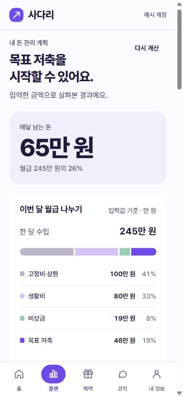

### 모바일 혜택 — 390×844

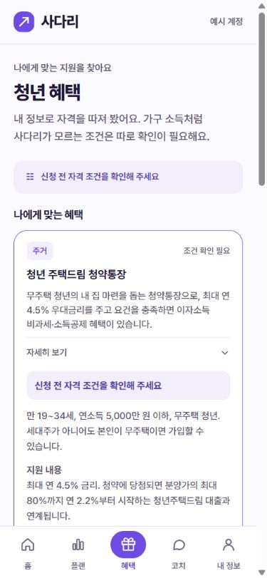

### 데스크톱 플랜 — 1440×900

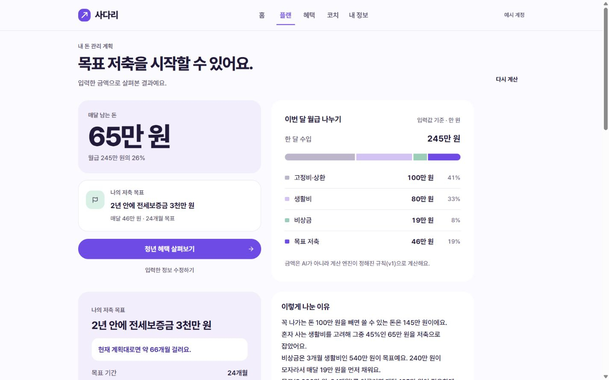

## 사용자 제공 iPhone 실기기 캡처

랜딩·홈·플랜·코치 화면이 휴대폰에서 열리는 것을 제공받은 캡처로 확인했다. 캡처상 주요 글자·금액·하단 메뉴가 표시되며, 가로로 잘려 사라진 주요 콘텐츠는 보이지 않는다. 코치의 추천 질문 행은 가로 스크롤 영역이다.

| 랜딩 | 홈 | 플랜 | 코치 |
|---|---|---|---|
| 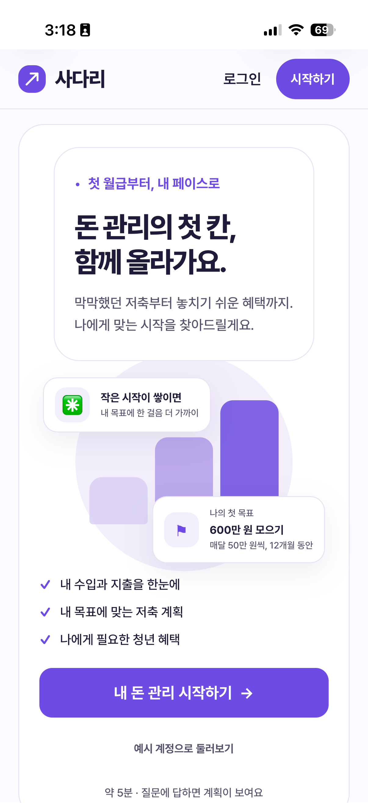 | 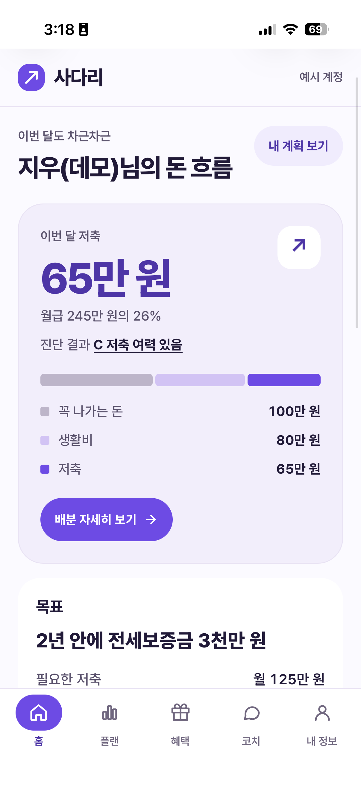 | 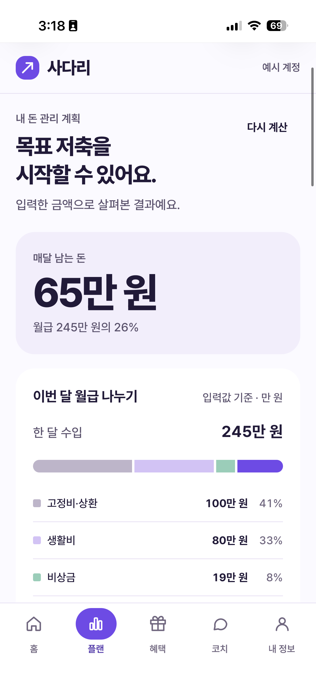 | 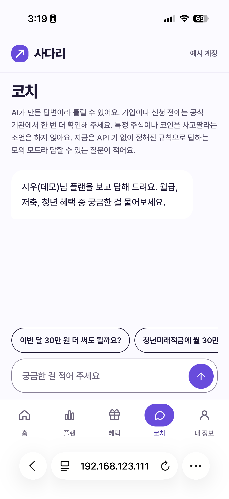 |

랜딩에서 중복된 카드 테두리와 iOS가 초록 이모지로 렌더링한 장식 문자를 발견했다. 내부 카드 테두리를 없애고 새싹·깃발을 SVG로 교체했다. 보완 후 로컬 390px 화면에서 내부 테두리 0px, 장식 SVG 2개, 가로 넘침 없음과 템플릿 회귀 검사 10개 통과를 확인했다. 위 원본 캡처는 이 보완 전 상태다.

보완 후 로컬 모바일 크기 캡처: [랜딩 화면](images/fe03-landing-mobile-fixed.jpg).

## 사용자 제공 Android 실기기 캡처

카카오톡 링크를 통해 접속한 안드로이드 캡처 6장을 제공받았다. 브라우저 앱 이름은 확인되지 않았으므로 삼성 인터넷 또는 Chrome 통과 자료로 분류하지 않는다.

- 랜딩·홈·코치의 기본 화면 표시 확인
- 코치 답변의 본문·출처·평가 버튼 표시 확인
- 혜택 목록의 펼친 카드와 혜택 상세 화면 표시 확인
- 홈 제목이 우측 버튼에 밀려 `돈 / 흐름`으로 나뉘는 것을 발견해, 좁은 화면에서는 버튼을 제목 아래에 두고 `돈 흐름`을 묶어 표시하도록 보완
- 보완 후 로컬 360·390·402px에서 버튼이 제목 아래에 배치되고 가로 넘침이 없음을 확인. 관련 홈 화면 회귀 검사 통과

보완 후 로컬 모바일 크기 캡처: [홈 화면](images/fe03-home-mobile-fixed.jpg).

| 랜딩 | 홈 | 코치 |
|---|---|---|
| 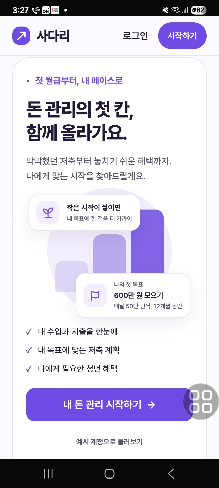 | 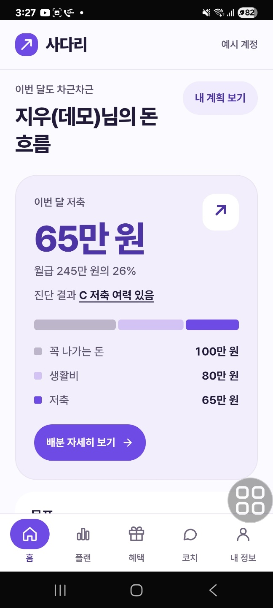 | 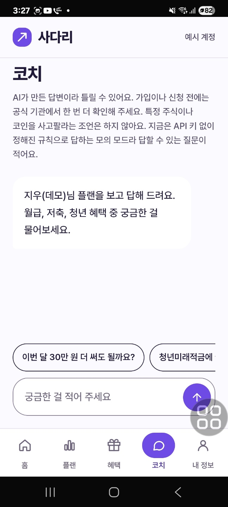 |

| 코치 답변 | 혜택 펼침 | 혜택 상세 |
|---|---|---|
| 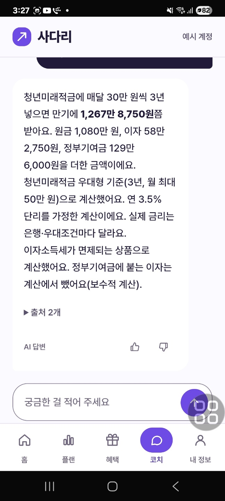 | 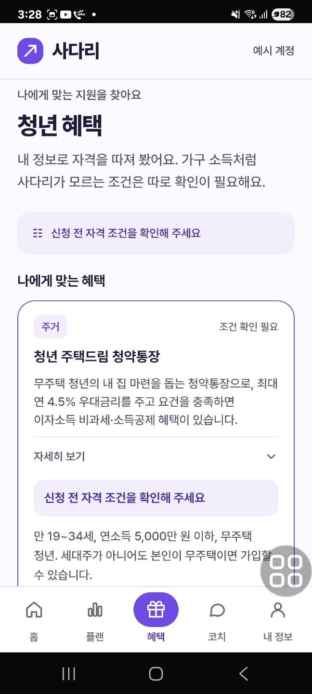 | 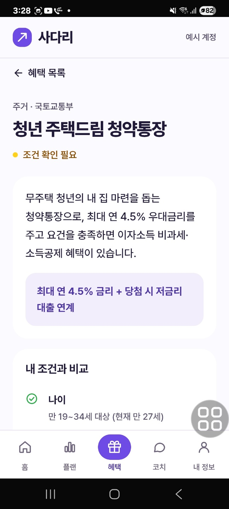 |

## 사용자 제공 Android Chrome 직접 실행 캡처

사용자가 Chrome 앱으로 다시 접속했다고 확인했고, Chrome 주소창이 보이는 캡처 7장을 제공받았다. 랜딩·홈·플랜·혜택·코치·내 정보의 화면 표시와 하단 메뉴의 선택 상태를 확인했다. 홈 제목 줄바꿈 보완이 반영됐으며, 코치 질문과 완료된 답변을 함께 확인했다. 내 정보 화면은 입력 필드의 표시만 확인했으며, 값 수정·저장과 음성 읽기 결과는 캡처만으로 확인하지 않았다.

| 랜딩 | 홈 | 플랜 |
|---|---|---|
| 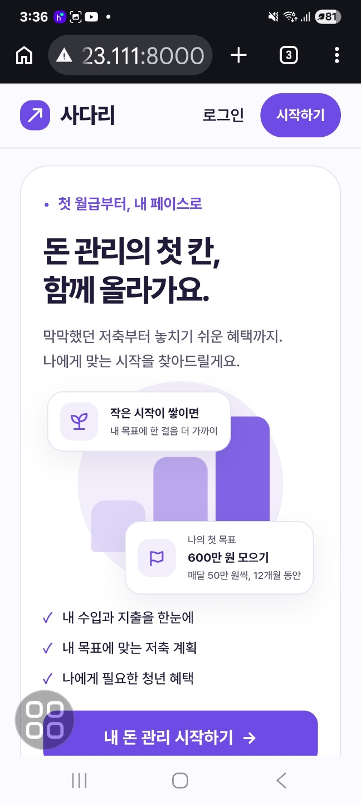 | 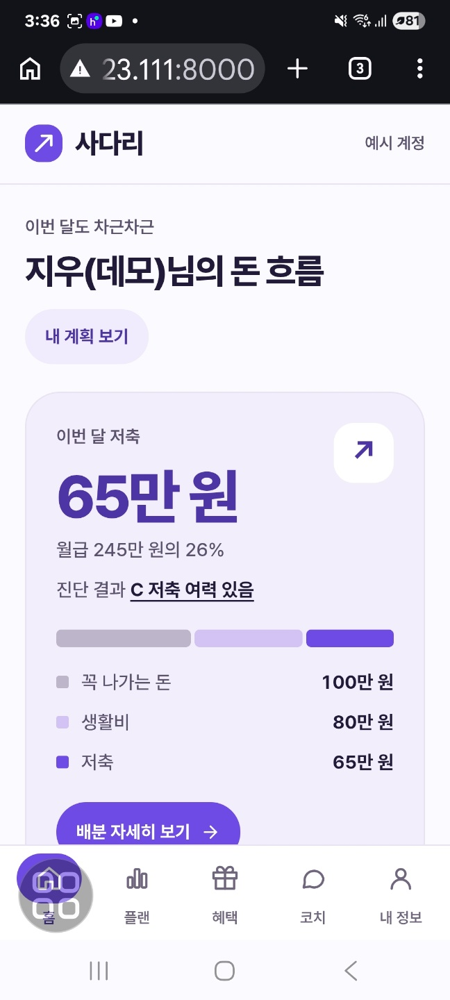 | 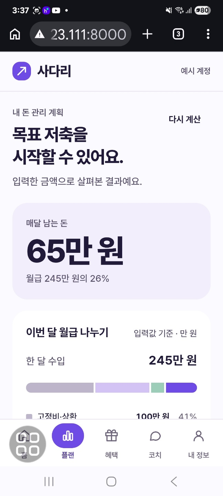 |

| 혜택 | 코치 초기 화면 | 코치 질문과 답변 |
|---|---|---|
| 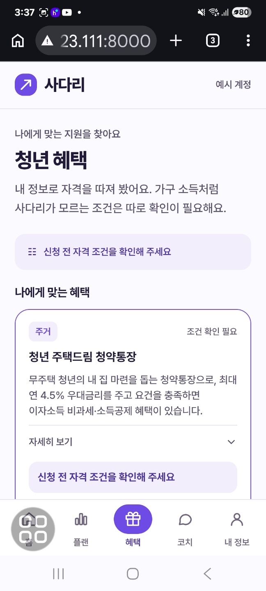 | 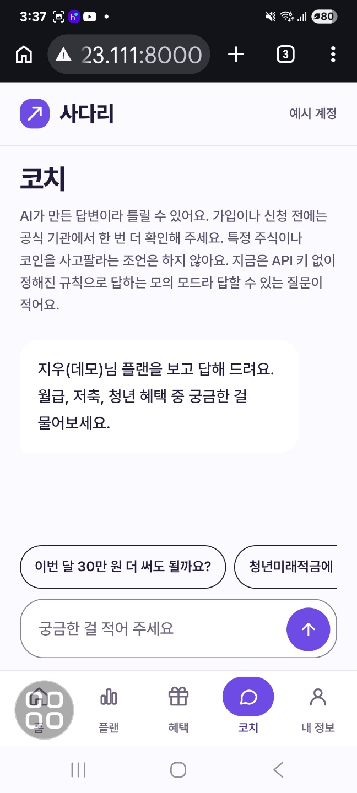 | 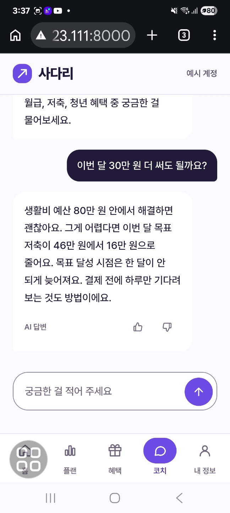 |

내 정보: [Android Chrome 캡처](images/fe03-chrome-settings.png).

## 답변 표시 속도 후속 보완

답변이 너무 빨리 표시된다는 사용자 피드백에 따라, 밀린 글자 수에 비례하던 표시 가속을 없애고 초당 약 45글자의 일정한 속도로 바꿨다. 응답 중 Enter로 제출해도 다음 질문 초안이 지워지지 않도록 보완했다.

이후 조금 더 빠르고 부드럽게 표시해 달라는 요청에 따라 최종 속도를 초당 약 55글자로 조정했다. 프레임 기반의 일정한 표시 방식을 유지하며, 60Hz·120Hz 모의 프레임에서 165글자가 약 3초에 표시되고 동작 줄이기에서는 즉시 표시되는 것을 확인했다. 아래 3.1초 측정은 앞선 45글자 설정에서의 실제 브라우저 확인 기록이다.

- 로컬 브라우저에서 `아하` 전송 후 일부 글자가 먼저 보이고, 약 3.1초 후 전체 예시 답변이 표시되는 것을 확인
- 표시 중 다음 질문을 입력하고 Enter를 눌러도 초안이 보존되고, 완료 후 보내기 버튼이 복구되는 것을 확인
- 가상 프레임 타이밍 검사로 일정한 속도, 큰 청크 수신 시 비가속, 답변 교체 즉시 표시, 동작 줄이기 즉시 표시, 백그라운드 완료, 한글·이모지의 최종 텍스트 보존 확인
- 새로 받는 답변의 시각적 표시 속도만 조정했으며, 저장된 대화는 다시 타이핑하지 않는다. 기존 준비 상태·완성 답변의 접근성 구조를 유지한다.

## 답변 준비 표시 후속 보완

- 새 질문에 “답변을 준비하고 있어요”와 순서대로 움직이는 점 세 개를 표시한다. 요청 시작부터 약 650ms가 지나면 기존 초당 55글자 표시를 시작한다. 서버 대기 시간을 포함하므로 응답에 이미 650ms 이상 걸렸다면 준비 시간을 추가하지 않는다.
- 스트림 수신은 계속 처리하며, 오류와 검증 교체는 준비 대기를 건너뛰고 즉시 표시한다. 동작 줄이기와 백그라운드에서는 글자 표시 대기도 생략한다. 점 애니메이션은 동작 줄이기에서 정지한다.
- 가상 60Hz·120Hz 프레임으로 준비 중 본문 숨김, 느린 서버 응답에 추가 대기 없음, 초당 55글자 유지, 오류·교체 즉시 표시, 동작 줄이기 전환과 정리 동작을 확인했다.
- 로컬 브라우저에서 `아하` 전송 약 0.39초 후 준비 표시가 보이는 것을 캡처했다. 답변 완료 후 준비 표시 제거, `aria-busy=false`, 피드백 버튼과 보내기 버튼 복구를 확인했다. `node --check`, Ruff, pytest 93개도 통과했다.

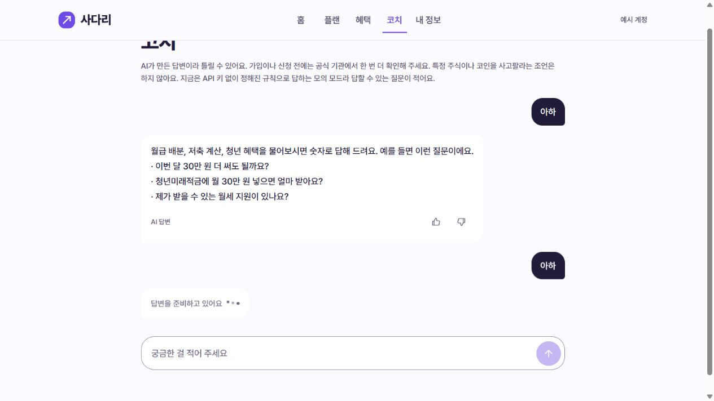

## 실기기 최종 확인 현황

- [x] 제공 시점 iPhone의 랜딩·홈·플랜·코치 기본 화면 표시 확인
- [x] 제공 시점 Android의 기본 화면·코치 답변·혜택 펼침과 상세 화면 표시 확인 (카카오톡 링크 접속, 브라우저 미확인)
- [x] Chrome 앱 직접 실행 후 주요 화면·하단 메뉴 선택 상태·코치 질문과 답변 표시 확인
- [x] 최신 버전의 스크린 리더 읽기 확인 — 사용자 확인 결과
- [x] 기기의 동작 줄이기 설정 확인 — 사용자 확인 결과

화면·채팅 표시 보완 후, 사용자에게 스크린 리더 읽기와 동작 줄이기를 최종 확인하도록 안내했고 사용자가 두 항목 모두 확인했다고 응답했다. 실기기 결과는 사용자 확인과 제공 캡처에 근거하며, 에이전트가 휴대폰이나 VoiceOver·TalkBack을 직접 조작한 결과는 아니다. 기기·OS 버전, iPhone 랜딩 보완 후의 추가 캡처, 내 정보 값 수정·저장에 대한 실기기 상세 로그는 제공되지 않았다.

구현과 점검 결과를 리뷰 가능한 상태로 정리했다. Draft는 사용자의 유지 요청에 따라 그대로 두며, 완료된 PR의 리뷰·승인·머지는 별도 단계다.
