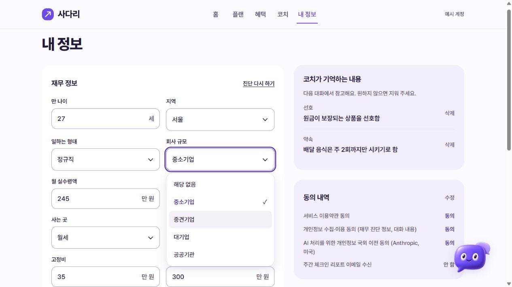
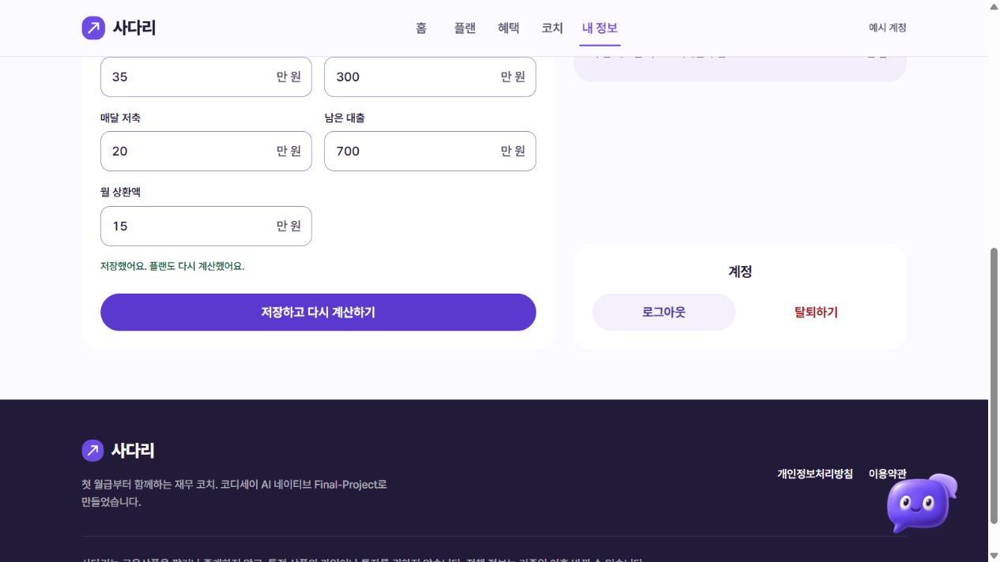
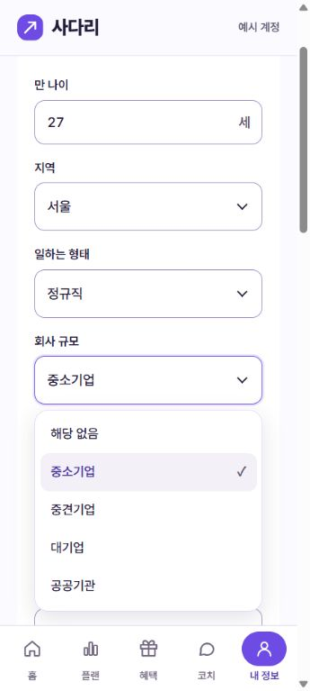
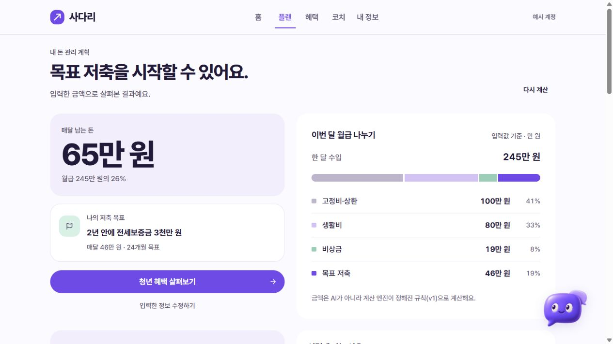
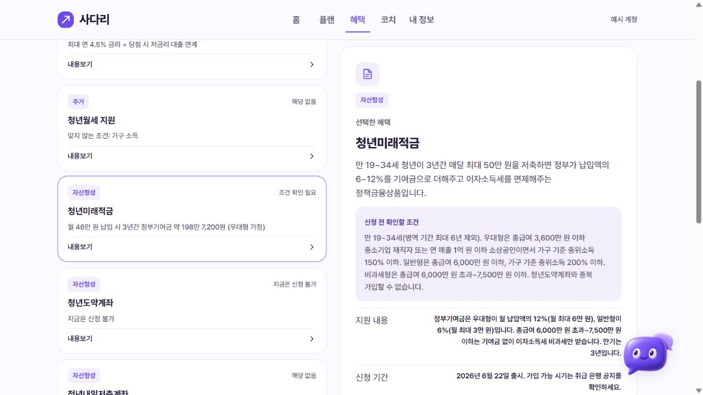
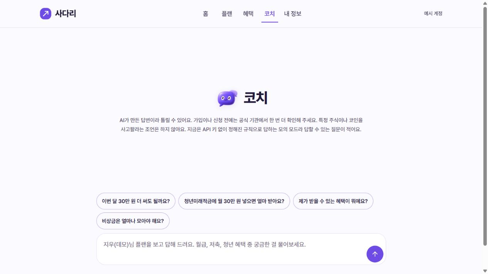
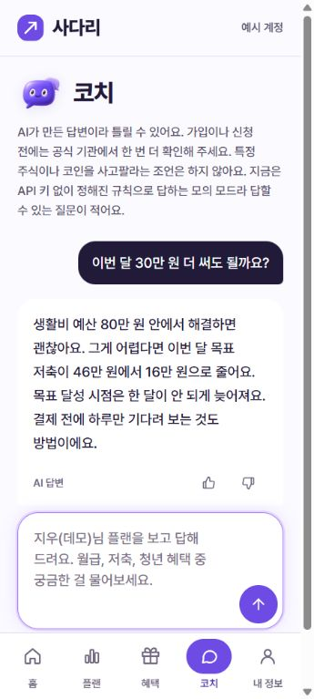
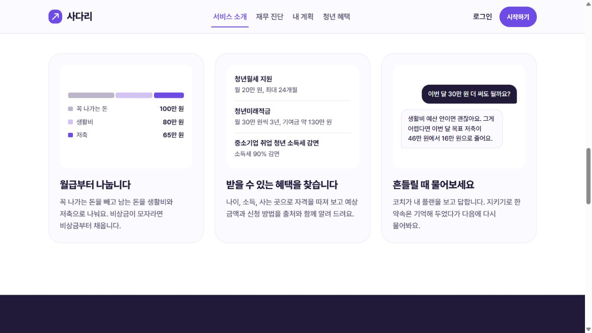

# FE-03 후속 UI 점검 — 2026-11-02

이슈 #16 · PR #48 · `feature/FE-03-ui-accessibility`

이 보고서는 [11월 1일 점검](FE-03-2026-11-01.md) 이후의 수정과 검증을 기록한다. PR의 Draft 상태는 변경하지 않았다.

## 반영한 요청

| 항목 | 최종 동작 |
|---|---|
| 내 정보 선택 메뉴 | 둥근 목록, 선택 체크, 회색 강조. 방향키·Home·End·Enter·Space·Esc·Tab 및 글자 검색 지원. 원래 select의 값을 유지해 저장하고, JavaScript가 없으면 기본 select를 사용한다. |
| 입력 테두리 | 나이·금액·선택 항목을 연보라 `#9b86c3`로 통일하고 포커스는 진한 보라로 강조한다. |
| 내 정보 오른쪽 | ‘삭제’·‘수정’으로 변경하고 동의 상태와 오른쪽 끝을 맞췄다. 기억·동의 카드는 연보라 면, 동의 상태는 보라 글자. 계정 제목은 중앙, 버튼 하단은 저장 버튼과 정렬한다. |
| 플랜 너비 | 두 열 화면에 남아 있던 5·7칸 지정과 시뮬레이터의 7칸 지정을 정리했다. 배분·이유·내 정보의 오른쪽 끝이 다시 계산과 같은 페이지 폭을 따른다. |
| 혜택 목록 | 7개 정책 모두 왼쪽 ‘내용보기’를 누르면 오른쪽 요약이 바뀐다. 상세 이동은 오른쪽 ‘혜택 자세히 보기’에서 한다. 키보드와 선택 상태 안내, JavaScript 미사용 시 query 링크 대체 경로를 제공한다. |
| 코치 초기 화면 | 이전 첫 인사 말풍선과 추가 빈 대화 문구를 제거했다. 캐릭터·제목·한계 안내는 빈 공간 중앙에, 긴 인사 문구는 입력창 placeholder에 둔다. 질문 후에는 제목이 위로 돌아오고 대화가 이어진다. |
| 코치 예시·입력 안내 | 예시 질문은 연보라 경계와 호버·키보드 강조. placeholder는 `#7a7089`로 조금 연하게 표시하고 긴 문구가 줄바꿈되도록 높이를 확보한다. 입력의 이름·설명은 별도로 제공한다. |
| 랜딩 내부 효과 | 카드 면은 초반에 선명해져 내부 움직임을 가리지 않는다. 두 번째 카드 항목은 300ms, 세 번째 질문은 70ms 뒤 380ms·답변은 240ms 뒤 480ms 동안 등장한다. 동작 줄이기에서는 생략한다. |

## 상태 안내

- 공통 레이아웃에 페이지 이동·연결 상태 안내를 추가했다. 로그인·가입·동의·예시 계정·로그아웃의 일반 제출은 진행 상태와 중복 제출 방지를 제공하며, 뒤로 가기 복귀 시 버튼을 복구한다.
- 필수 입력의 빈 값과 형식 오류는 항목 옆 문구, `aria-invalid`, 연결된 설명과 폼 상태로 안내한다. 오류 문구가 입력 이름에 섞이지 않도록 이름을 명시한다.
- 내 정보는 저장 중·완료·오류를 해당 폼에 유지한다. 기억 삭제에도 진행·완료·실패와 재시도 안내를 둔다.
- 플랜 시뮬레이터는 초기 입력 안내, 빈 값·기간 범위 오류, 계산 중·완료·서버 오류 상태를 표시한다. 숨긴 기간 칸은 화면 배치에서 제외한다.
- 코치는 준비 상태, 스트림 완료 후 busy 해제, 빈 질문·연결 오류 안내와 재입력 동작을 유지한다. 정적 안내 페이지에는 실제로 존재하지 않는 로딩·빈 결과를 만들지 않는다.

## 자동 검사

- `pytest -q`: **100 passed**. 선택 메뉴의 Node 회귀 6개를 실행하는 검사와 최종 화면 회귀 6개를 포함한다.
- Node 선택 메뉴 회귀: 선택값·체크 동기화, Esc 취소, Enter 확정과 이벤트·포커스, 마우스 선택·외부 값 변경, 하나의 메뉴만 열기·외부 클릭·Tab 닫기, Home·End·글자 검색 통과.
- 서버 화면 회귀: 모든 정책의 미리보기 선택, 잘못된 선택의 안전한 대체, 코치 빈 대화·입력 안내, 원래 선택 항목과 필수 입력 유지, 플랜 두 열 배치, 공통 상태 영역 통과.
- `ruff check .`, `node --check app/static/js/app.js`, `git diff --check` 통과.
- 프로젝트 AI 평가: 검색 12개 hit@1·hit@3·근거 포함 100%, 가드레일 10개 탐지 100%.

## 실제 브라우저 확인

Chromium 기반 인앱 브라우저의 PC 기본 크기와 360×800 모의 모바일을 사용했다. localhost의 별도 예시 계정으로 확인했으며 실제 사용자 프로필을 수정하지 않았다.

| 확인 | 결과 |
|---|---|
| 선택 메뉴 | 현재 값 체크, 방향키 이동 후 Esc 취소, 원래 값 보존 확인. 모바일 항목 높이 44px, 화면 안에서 목록 표시 |
| 저장 상태 | 빈 나이 제출 시 오류와 나이 입력 포커스, 값 복구 후 저장·재계산 완료 문구 확인 |
| 설정 정렬 | 삭제·수정·동의 상태의 오른쪽 끝이 같음. 계정 버튼과 저장 버튼 하단이 같음 |
| 플랜 | PC 배분·이유·시뮬레이터·내 정보 카드의 오른쪽 끝과 페이지 끝 차이 0.02px 미만. 모바일은 한 열 |
| 계산 상태 | 빈 납입액의 범위 안내와 입력 포커스, 정상 값 복구 후 결과 표시·버튼 복구 확인 |
| 혜택 | 7개 모두 클릭 후 `/benefits`에 머물며 해당 제목·선택 표시·상태 안내가 바뀜 |
| 코치 | 중앙 초기 안내, 추가 빈 대화 문구 없음, 연한 placeholder와 예시 질문 강조 확인. 질문 후 중앙 배치 해제·준비 상태·완성 답변·busy 해제 확인 |
| 너비·오류 | 점검한 PC·모바일 화면에서 가로 넘침 없음. 브라우저 오류 로그 없음 |
| 랜딩 | 세 카드의 내용이 최종적으로 모두 보임. 두 번째 300ms, 세 번째 380/480ms 효과와 각 지연을 브라우저 적용값으로 확인 |

색상 계산에서는 설정 입력 경계 `#9b86c3`와 흰색의 대비가 **3.19:1**, 코치 placeholder `#7a7089`와 흰색의 대비가 **4.66:1**이었다. 전체 WCAG 적합성 인증을 의미하지 않으며, 이전 보고서의 대비·터치·키보드 점검도 함께 참고한다.

## 리뷰 준비 상태와 남은 확인

- 코드·로컬 자동 검사·PC 및 모의 모바일 확인 결과로는 리뷰를 요청할 수 있는 상태다. 새 PR을 만들 필요 없이 기존 #48에서 이어간다.
- iOS Safari·Android Chrome 실기기와 스크린 리더의 이전 사용자 확인 기록은 11월 1일 보고서에 있다. **이번 선택 메뉴와 중앙 코치 화면을 반영한 최종 버전의 실기기·VoiceOver/TalkBack 확인은 아직 별도 완료로 기록하지 않았다.**
- 최종 휴대폰 확인 항목: 메뉴 열기·선택·Esc 또는 바깥 터치 닫기·저장, 코치 첫 화면·질문 전송, 선택한 항목과 완성 답변의 음성 읽기, 동작 줄이기 설정.
- 배포 환경에서의 후속 확인과 팀원 승인·머지는 별도 단계다. Draft 해제·머지·이슈 닫기는 수행하지 않았다.

## 화면

