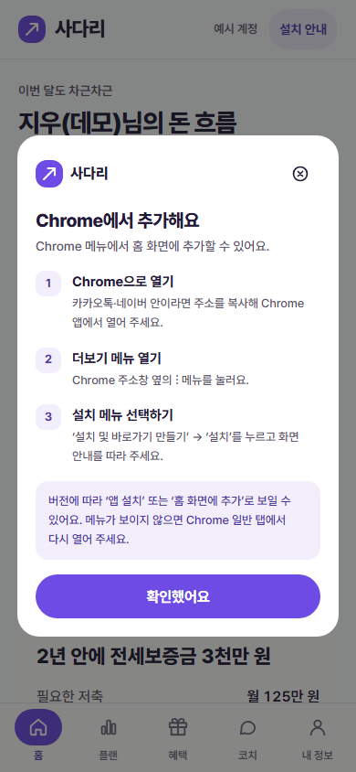
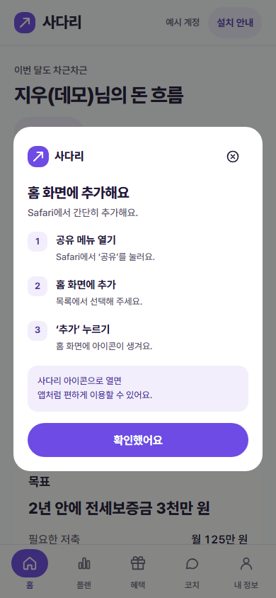

# FE-04 안드로이드 설치 안내 버튼 보완

브랜치: `feature/FE-04-android-install-guide` · 기준 main: `b1f529a7bb54fd0751491324b441e3501672bb69` · Refs #17.

## 문제와 변경

PR #51 병합 후에도 안드로이드에서 설치 버튼이 보이지 않는 보고가 있었다. 기존 코드는 `beforeinstallprompt`를 받기 전까지 안드로이드 버튼을 숨겼다. 이 검증은 그 기기에서 이벤트가 오지 않은 근본 원인을 확인한 결과가 아니라, 이벤트가 없어도 설치 방법에 접근할 수 있도록 표시 흐름을 보완한 것이다.

- 보안 컨텍스트의 모바일 브라우저에서 설치 이벤트가 없어도 **설치 안내** 버튼을 표시한다. 기존 헤더의 단일 버튼·CSS·보라색 테마·계정 버튼이 있는 화면의 다음 줄 배치를 그대로 사용한다. 아이폰과 안드로이드의 기본 안내 버튼 위치·크기는 같다.
- 안드로이드에서 유효한 설치 이벤트가 준비되면 **앱 설치**로 바꾸고 해당 브라우저의 설치창을 연다. 이벤트는 한 번만 사용하며 진행 중 중복 클릭을 막는다.
- 설치 이벤트가 없거나 설치창 호출이 실패하면 같은 모양의 안내창에 **Chrome으로 열기 → 주소창 옆 ⋮ → 설치 및 바로가기 만들기 → 설치**를 안내한다. 카카오톡·네이버 내부라면 주소를 복사해 Chrome 앱으로 열도록 설명한다. 메뉴명 차이에 대한 안내도 제공한다.
- 사용자가 설치창을 취소했을 때 안내창을 자동으로 다시 띄우지 않는다. 이후 버튼을 다시 누르면 안내를 볼 수 있다.
- 아이폰의 Safari 안내 내용·디자인을 유지한다. 공통 dialog에서 기기에 맞는 단계만 보여 주며, 숨겨진 안내가 기존 `display:grid`에 의해 드러나지 않도록 스타일을 한 줄 추가했다.
- `appinstalled`를 받은 현재 페이지에서는 버튼을 숨기고 열린 안내를 닫는다. standalone·아이폰 navigator.standalone·PC·비보안 컨텍스트에서는 버튼을 숨긴다. PC의 브라우저 자체 설치 이벤트는 가로채지 않는다.

## 검증

- `ruff check .`, JavaScript 구문, `git diff --check` 통과.
- pytest **103개** 통과. 공개·로그인·회원 페이지의 공통 버튼과 단계 안내를 검사한다.
- Node 설치 이벤트 회귀 **6개** 통과. 실제 `initPwaInstall` 함수를 모의 DOM/브라우저 이벤트 환경에서 실행해 기본 표시, iOS 분리, 이벤트 한 번 사용, 실패 대체 안내, 중복 호출 방지, 설치 후 숨김, PC/standalone/비보안 조건을 확인한다.
- Chromium 브라우저 확인 **89개** 통과. 320×568·390×844, iPhone/Android UA, 로그인/홈 화면에서 위치·너비·테마·헤더 잘림·팝업 경계·플랫폼 단계 분리·초점·확인/닫기/Escape를 확인했다.
- 모의 설치 이벤트의 정상 호출·취소·실패·대기 중 중복 클릭·설치 완료를 확인했다. 카카오톡 UA, PC, standalone, navigator.standalone, 비보안 컨텍스트, dialog 미지원의 안내 대체도 확인했다. 플랫폼별 검사에서 JS 오류는 0이었다.

## 실제 기기 확인은 남음

모바일 화면 검사는 데스크톱 Chromium의 모바일 에뮬레이션이며, 실제 Android Chrome의 설치창·기기 설치 완료를 증명하지 않는다. `beforeinstallprompt`, `userChoice`, `appinstalled`는 검증에서 모의 이벤트로 제어했다. localhost의 보안 컨텍스트에서 실행했으며 운영 HTTPS·실제 iPhone Safari·Galaxy Chrome·카카오톡 브라우저 확인은 후속이다.

설치 안내 버튼은 브라우저에 설치 메뉴를 강제로 만들지 않는다. 이미 설치된 앱을 일반 브라우저의 다른 탭에서 열었는지도 모든 브라우저에서 판별하지는 않는다. standalone과 현재 페이지가 받은 설치 완료 이벤트는 구분한다.

## 화면

가짜 데모 계정을 사용한 실제 로컬 앱 캡처다. 기존 보라색 UI와 공통 헤더 위치를 유지한다.

## 근거

- [Google Chrome 고객센터: Android 웹 앱 설치](https://support.google.com/chrome/answer/9658361?co=GENIE.Platform%3DAndroid&hl=ko)
- [Chrome 개발 문서: 앱 내 설치 흐름과 이벤트](https://web.dev/articles/customize-install)

Codex로 표시 조건·안내창·검사를 작성했다. 변경은 이 새 브랜치에만 반영하며 기존 PR #51·main·다른 FE 브랜치를 수정하지 않는다. Draft PR로 공유하고 실기기 검증 전 FE-04 전체 완료로 보고하지 않는다.
